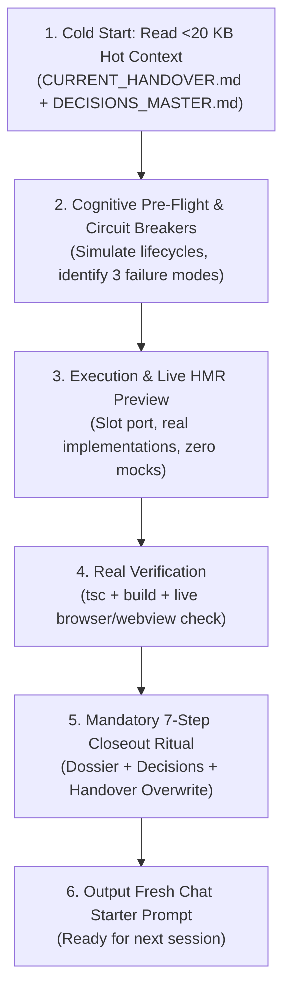

# MindFlow Autonomous "1 Chat = 1 Version" Workflow Skill (`version-ritual`)

This skill defines the end-to-end execution lifecycle for every autonomous AI chat session working on the MindFlow repository. It enforces the ironclad rule: **1 Chat = 1 Version = 1 Complete Handover Baton**.

---

## 🔁 The Perpetual Lifecycle



---

## Phase 1: Cold-Start & Cognitive Pre-Flight

### 1.1 Read Ultra-Lean Hot Context (<20 KB)
Every fresh chat session MUST read ONLY the three Hot Context files to prevent context bloat and hallucination:
1. `docs/handovers/CURRENT_HANDOVER.md` (The live baton with current baseline and next task brief).
2. `docs/DECISIONS_MASTER.md` (Active technical invariants and superseded approaches).
3. Active milestone in `docs/blueprint/v1.0_blueprint.md` (The current 10-step roadmap slice).

> [!WARNING]
> NEVER read historical version dossiers (`docs/versions/*`), the full changelog (`docs/APP_JOURNEY_LOG.md`), or legacy ADRs on session startup. They are on-demand archives only.

### 1.2 Git & Workspace Sanity Check
- Verify current slot and working branch (`git branch --show-current`, `git status`).
- Slot 1 (`D:\MindFlow-main`) owns `main`; Worker 1 and Worker 2 must branch from `origin/main`.
- Ensure working tree is clean.

### 1.3 30-Second Circuit Breaker Check ("Stop & Ask")
Pause and ask user confirmation immediately if the planned work will:
- Modify or create more than **10 files** in this session.
- Add, update, or remove **npm packages** or Gradle dependencies.
- Perform **destructive database migrations** (dropping tables/columns, truncating data).
- Break **public component contracts**, shared APIs, or database RPC signatures.
- Modify **authentication logic**, OAuth hash token extraction, or route permissions.

### 1.4 System-2 Cognitive Pre-Flight
Before editing any file:
1. **Lifecycle Simulation:** Trace component mount, unmount, re-render, backgrounding, and network loss.
2. **Failure Mode Analysis:** Explicitly identify at least 3 concrete runtime failure modes (e.g., race conditions, stale IndexedDB state, unhandled promise rejections, mobile viewport shifts).
3. **Zero-Shortcut Enforcement:** Strictly ban cosmetic fake UI stubs, static dummy mocks, empty placeholders masquerading as features, or hardcoded timeouts simulating async work. Everything must be wired end-to-end to real state, real storage, or real APIs.

---

## Phase 2: Isolated Execution & Manifest Synchronization

### 2.1 Branch Creation
- Slot 1: `git checkout -b feat/vX.Y.Z-<task-slug>`
- Worker 1 / 2: `git checkout -B feat/vX.Y.Z-<task-slug> origin/main`

### 2.2 Version Manifest Synchronization
Whenever a new version cycle begins, bump the version:
- `package.json`: `npm version patch --no-git-tag-version` (e.g. `1.0.365` $\rightarrow$ `1.0.366`).
- `android/app/build.gradle`: Increment `versionCode` by 1 and update `versionName` when modifying native mobile or Capacitor behavior.

### 2.3 Live HMR & Real-World Development
- Develop directly in the workspace slot.
- Dev server runs on deterministic port:
  - Slot 1: `npm run dev` (`http://localhost:3000/`)
  - Slot 2: `npm run dev -- --port 3001` (`http://localhost:3001/`)
  - Slot 3: `npm run dev -- --port 3002` (`http://localhost:3002/`)
- Test live edits in milliseconds using Vite HMR without committing to git.
- Record live *Path A vs Path B* trade-offs in memory for the decision ledger.

---

## Phase 3: Comprehensive Verification

### 3.1 Static Verification
Run static validation (use `npx.cmd` on Windows):
1. **TypeScript Typecheck:** `npx.cmd tsc --noEmit` (Must pass with 0 errors).
2. **Vite Production Build:** `npx.cmd vite build` (Must complete cleanly).
3. **Unit Tests (when applicable):** `npx.cmd vitest --run --pool=forks`.

### 3.2 Real-World Runtime Verification
Never declare a task done based solely on passing unit tests or static builds:
- Open the assigned localhost preview URL in a real browser or WebView.
- Verify touch feedback (`active:scale-95`), scroll ergonomics, and keyboard avoidance.
- Verify offline behavior if modifying IndexedDB or Dexie storage logic.

---

## Phase 4: Mandatory 7-Step Closeout Ritual (The Perpetual Handover Loop)

> [!CRITICAL]
> No chat session is ever allowed to conclude with a casual "I'm done". Every chat session MUST automatically complete all 7 closeout steps below.

### Step 1: Create Per-Version Dossier
Create `docs/versions/vX.Y.Z.md` using `docs/versions/00-template.md`:
- Record Release Metadata, Executive Summary, Features & Impacted Files, Engineering Decisions (Path A vs Path B), Runtime Bugs Caught & Fixes, and Verification Proof.

### Step 2: Update Master Decision Ledger
Append newly minted decisions to `docs/DECISIONS_MASTER.md`:
- Add to Table 1 (`## 1. Active Decisions & Invariants`).
- If any previous approach was retired, move it to Table 2 (`## 2. Superseded Decisions (Do NOT Revive)`).

### Step 3: Prepend Entry to App Journey Log
Prepend a release entry to `docs/APP_JOURNEY_LOG.md` immediately below the `---` divider:
- Format: `## [vX.Y.Z] - DD MMMM YYYY, HH:MM AM/PM IST`
- Group changes under `### ✨ Features Added`, `### 🐛 Bug Fixes`, `### ⚡ Performance & Refactoring`, or `### 🔒 Security & Architecture`.

### Step 4: Update Roadmap Blueprint
In `docs/blueprint/v1.0_blueprint.md`:
- Mark the completed milestone as `[x] DONE`.
- Refine the deliverables and scope for the next upcoming milestone.

### Step 5: Overwrite Live Handover Baton (`CURRENT_HANDOVER.md`)
Completely overwrite `docs/handovers/CURRENT_HANDOVER.md` with:
1. Current Verified Baseline Snapshot (new version, git commit, test status).
2. Workstation & Runtime Testing Rules.
3. Pre-Planned Execution Brief for Next Version.
4. Mandatory Closeout Checklist.
5. Exact Copy-Paste Starter Prompt for the next fresh chat.

### Step 6: Zero-Leak Privacy & Secret Scan
Before committing, inspect staged changes:
- Verify zero hardcoded API keys, Supabase service tokens, credentials, personal emails, or local OS paths (`D:\MindFlow-main`, `C:\Users\...`).

### Step 7: Git Commit, PR & Branch Housekeeping
Commit and merge changes via GitHub CLI bridge:
```powershell
git add .
git commit -m "feat(core): release vX.Y.Z - <summary>"
& "C:\Program Files\GitHub CLI\gh.exe" auth setup-git
git push -u origin feat/vX.Y.Z-<task-slug>
& "C:\Program Files\GitHub CLI\gh.exe" pr create --title "vX.Y.Z: <summary>" --body "<Dossier summary>" --base main --head feat/vX.Y.Z-<task-slug>
```
Post-merge: Pull `main` in Slot 1, delete local feature branch, and verify clean git status.
Finally, output the Section 5 copy-paste starter prompt to the user!
