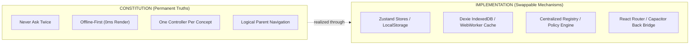
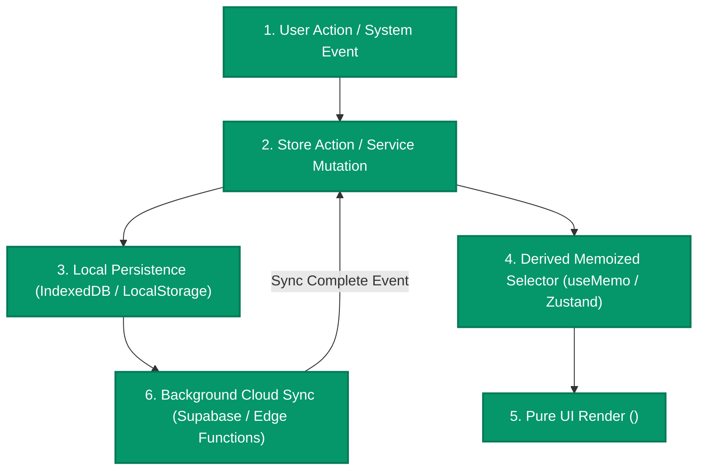
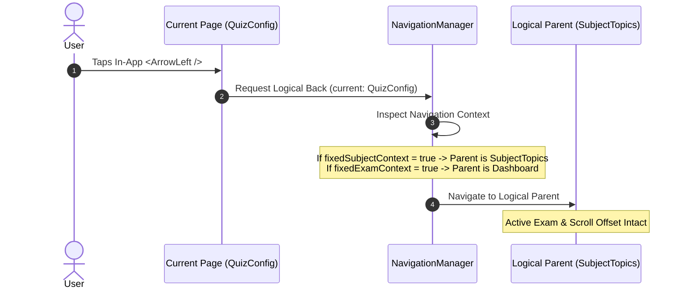

# The MindFlow Constitution & Product Operating Architecture (PRD v3.0)

> **Document Classification:** Supreme Architectural Standard & Product Constitution  
> **Authority Level:** Mandatory for All Human Engineers, Autonomous AI Agents, and Product Designers  
> **Persistence Standard:** Permanent (Outlasts individual libraries, frameworks, and feature iterations)  
> **Repository Grounding:** `d:\MindFlow-main` (PWA, Android Capacitor WebView, Desktop Web)  

---

```
                              MINDFLOW CONSTITUTION
  ┌────────────────────────────────────────────────────────────────────────────┐
  │  SECTION 1: The Immutable Product Commandments                             │
  │  SECTION 2: Constitution vs. Implementation Boundaries                     │
  │  SECTION 3: Global State Ownership Matrix                                  │
  │  SECTION 4: Unidirectional Data Flow Charter                               │
  │  SECTION 5: Immutable Product Contracts                                    │
  │  SECTION 6: Global UX Operating System & Progressive Disclosure             │
  │  SECTION 7: Offline-First Philosophy & Zero-Latency Hydration              │
  │  SECTION 8: Measurable Performance Budgets & SLAs                         │
  │  SECTION 9: Design Token System & Semantic Congruency                      │
  │  SECTION 10: AI & Extension Invariants                                     │
  │  SECTION 11: Observability, Diagnostics & Telemetry                        │
  │  SECTION 12: Feature Lifecycle Governance Standard                         │
  └────────────────────────────────────────────────────────────────────────────┘
```

---

## SECTION 1: The Immutable Product Commandments

These 10 principles represent the foundational truths of MindFlow. They do not bend to deadlines, convenience, or technological shifts.

1. **One Concept $\rightarrow$ One Control $\rightarrow$ One Location:** Every dimension of state must have exactly one visible controller in the active viewport. Duplicate controls breed cognitive paralysis.
2. **Never Ask Twice:** Once an aspirant specifies an exam, subject, or preference, that context is durable. Child screens inherit what parent screens established.
3. **Preserve Context on Clear:** "Clear Filters" resets transient query parameters (shifts, years, difficulties); it **never** wipes the user's exam goal, language, or mode unless explicitly commanded.
4. **Offline Is First, Not a Fallback:** If data exists locally in IndexedDB, the screen must render immediately (0ms). The network is strictly a background synchronization channel.
5. **Logical Back Outranks Historical Back:** In-app back buttons (`<ArrowLeft />`) return to the designated hierarchical parent; Android hardware back navigates the topmost modal/sheet layer before page pops.
6. **No Dead-End Empty States:** Every empty screen must diagnose the specific reason for zero results, prescribe the remedy, and supply a single-tap recovery action.
7. **Every Error Must Prescribe Its Fix:** Technical codes or generic "Error Occurred" strings are forbidden. Explain what happened, why, and how the user escapes it.
8. **The App Adapts to the Exam, Not Vice-Versa:** Shift filters, year lists, and drill topics dynamically reflect the active examination. Incompatible options are pruned before render.
9. **Zero-Amnesia Continuity:** Interrupted quizzes, in-flight answers, and drafted filter configurations must survive OS app kills, browser refreshes, and battery shutdowns.
10. **Motion Communicates State, Not Vanity:** Animation exists solely to provide physical feedback, clarify visual hierarchy, and signal confirmation. Gratuitous motion is banned.

---

## SECTION 2: Constitution vs. Implementation Boundaries

A resilient product architecture cleanly separates **Why and What** (Permanent Product Philosophy) from **How** (Swappable Technology Stack).



| Constitutional Mandate (Permanent) | Current Implementation (May Evolve) | Permissible Future Swap |
| :--- | :--- | :--- |
| **Instant Client Hydration (<10ms)** | Dexie IndexedDB + React Query Cache | SQLite Wasm, OPFS, or Native DB |
| **Single State Authority** | Zustand Persistent Stores (`useExamContextStore`) | Redux Toolkit, Jotai, or Signals |
| **Strict Subpath & Native Routing** | `<HashRouter>` in `src/App.tsx` | Browser History API (if subpath dropped) |
| **Backend & Sync Channel** | Supabase Postgres + RLS + Edge Functions | Firebase, 自建 Postgres, or GraphQL |
| **Multi-Platform Wrapper** | Capacitor Android Native Plugins | React Native, Tauri, or Pure PWA |
| **Atomic Design Styling** | Tailwind CSS + Centralized Config Tokens | CSS Modules, StyleX, or Vanilla CSS |

---

## SECTION 3: Global State Ownership Matrix (Highest Priority)

To eliminate state duplication, race conditions, and divergent views, every slice of application state is assigned to **exactly one authoritative owner**.

```
┌────────────────────────────────────────────────────────────────────────┐
│                        STATE OWNERSHIP RULES                           │
├────────────────────────────────────────────────────────────────────────┤
│  1. Exactly ONE store owns each slice of state.                        │
│  2. Child components READ via derived selectors.                       │
│  3. Mutations occur ONLY through exported store actions.               │
│  4. Downstream screens NEVER maintain shadow local state.              │
└────────────────────────────────────────────────────────────────────────┘
```

### 3.1 State Ownership Registry

| State Entity | Sole Owner Store | Primary Storage Mechanism | Authorized Consumers | Prohibited Behaviors |
| :--- | :--- | :--- | :--- | :--- |
| **Active Target Exam** | `useExamContextStore` | `localStorage` (`mindflow_exam_context`) + Supabase profile | `Dashboard`, `QuizConfig`, `SubjectHub`, `AI Coach`, `MistakeNotebook`, `Bookmarks` | Component holding its own `currentExam` state; resetting exam upon clearing topic filters. |
| **Pinned Exam List** | `useExamContextStore` | `localStorage` (`mindflow_pinned_exams`) | `ExamQuickAccessStrip`, `ManageTargetExamsModal` | Hardcoding pinned exam arrays inside page templates. |
| **Active Subject / Topic** | Route URL Context | React Router params (`/subject/:subjectName`) | `SubjectHubPage`, `SubjectTopicsPage`, `QuizConfig` | Passing subject names via volatile window globals or uncontrolled React state. |
| **Draft Quiz Filters** | `useQuizConfigStore` | `sessionStorage` (`mindflow_draft_filters`) | `QuizConfig.tsx` | Re-requesting exam or resetting drafted filters on accidental page pop. |
| **In-Flight Quiz Session** | `useQuizSessionStore` | Dexie IndexedDB (`db.saved_quizzes`) | `LearningSession`, `MockSession`, `ResultGuard` | Storing answers solely in React `useState`; dropping state on browser refresh. |
| **Question Taxonomy Cache** | `useQuestionMetadata` | Dexie IndexedDB (`db.cached_metadata`) + Memory | `QuizConfig`, `SubjectStrip`, `ExamCard` | Triggering full Supabase SQL RPCs when client cache is warm (<24h). |
| **Cognitive Mastery Records** | `masteryService` | Dexie IndexedDB + Supabase `user_question_mastery` | `MistakeNotebookPage`, `MasteryDrillBar`, `CognitiveDeck` | Calculating vulnerability index ad-hoc inside UI render loops. |
| **Bookmarked Questions** | `useBookmarkStore` | Dexie IndexedDB (`db.bookmarks`) + Cloud Sync | `BookmarksPage`, `DashboardGreeting`, `QuestionCard` | Storing bookmark state as a boolean on question objects without syncing. |
| **User Profile & Stats** | `useAuth` / `useProfileStats` | Supabase Auth Session + `localStorage` | Entire Application | Polling Supabase for profile data on every route change. |
| **Global UI Overlays** | `useNotificationStore` / `useLayoutStore` | In-Memory (Zustand) | `App.tsx`, `MainLayout.tsx` | Direct DOM manipulation for alerts, toasts, or bottom bar spacing. |

---

## SECTION 4: Unidirectional Data Flow Charter

MindFlow strictly enforces **Unidirectional Data Flow**. Data flows downwards; events flow upwards. 

### 4.1 Permitted Data Flow Pipeline



### 4.2 Forbidden Architectural Anti-Patterns

> [!CAUTION]
> The following patterns violate the MindFlow Constitution and will be rejected in code review:
>
> 1. **Prop-Drilling Component Chains:** Passing state down through $>2$ intermediate components instead of consuming the owning Zustand store directly.
> 2. **Component-to-Component Shadow State:** Component A copying state from Store X into local `useState`, mutating it locally, and attempting to keep it in sync via `useEffect`.
> 3. **Two-Way Synchronization Loops:** Component subscribing to a store and simultaneously dispatching updates back to that same store inside a render effect.
> 4. **Direct Cloud Mutations Bypassing Local Cache:** Making direct `supabase.from('...').insert()` calls from UI components without writing first to Dexie IndexedDB.

---

## SECTION 5: Immutable Product Contracts

Contracts define guaranteed behavior. They have fixed inputs, deterministic outputs, and zero unintended side effects.

### 5.1 Quiz Generation Contract (`quizCreationService`)

```typescript
// Formal Input Specification
interface QuizGenerationInput {
  canonicalExamId?: string;       // e.g., 'ssc_cgl'
  filters: FilterState;           // Subject, Topic, Difficulty, Year, Shift
  mode: 'learning' | 'mock';      // Untimed tutor vs timed examination
  customTitle?: string;           // Optional user title
  questionCount?: number;         // Defaults to 25 if unspecified
}

// Guaranteed Output Specification
interface QuizGenerationResult {
  quizId: string;                 // Deterministic Dexie/UUID identifier
  reusedSession: boolean;         // True if resuming an existing paused attempt
  totalQuestions: number;         // Exactly matches available pool
  sessionRoute: string;           // Guaranteed destination: `/quiz/session/${mode}/${quizId}`
}
```

* **Contract Invariants:**
  1. **Deterministic Direct Launch:** Quiz generation **must navigate directly** to `/quiz/session/...`. Redirecting to `/quiz/library` is strictly breach of contract.
  2. **Zero Global Leakage:** If `canonicalExamId` is provided, questions returned **must strictly match** `canonicalExam.dbExamNames`. Questions from other exams must never bleed in.
  3. **Permitted Side Effects:** Write to Dexie `db.saved_quizzes`, enqueue background cloud sync, emit `quiz_generated` telemetry event.
  4. **Forbidden Side Effects:** Resetting global active exam, clearing unrelated user bookmarks, blocking the UI thread with synchronous calculations.

### 5.2 Exam Context Switch Contract

Whenever `activeExamId` changes in `useExamContextStore`:
1. The global store writes the new ID to `localStorage`.
2. Downstream selectors automatically recalculate:
   - `availableYears` $\rightarrow$ Scoped strictly to the new exam.
   - `availableShifts` $\rightarrow$ Scoped strictly to the new exam's papers.
   - `examQuestionCount` $\rightarrow$ Live counter refreshed from IndexedDB.
   - `dashboardWidgets` $\rightarrow$ Themed to the exam's canonical color tokens.
3. Incompatible drafted shift/year filters are **automatically relaxed** without requiring user intervention.

### 5.3 Logical Back Navigation Contract



---

## 6. Global UX Operating System & Progressive Disclosure

### 6.1 The Three-Tier Disclosure Ladder

```
┌────────────────────────────────────────────────────────────────────────┐
│  TIER 1: Instant Intent (Zero Scroll - Above the Fold)                 │
│  • Target Subject & Topic Capsules                                     │
│  • Question Count (10, 20, 25, 50)                                     │
│  • Difficulty Segment (All, Easy, Medium, Hard)                        │
│  • CTA: [⚡ Start Practice Now]                                         │
├────────────────────────────────────────────────────────────────────────┤
│  TIER 2: PYQ Scoping (Single-Tap Expansion Accordion)                  │
│  • Exam Years (Scoped strictly to Active Exam)                         │
│  • Exam Shifts / Dates (Scoped strictly to Selected Year)              │
│  • Question Types (MCQ, Assertion-Reason, Match)                       │
├────────────────────────────────────────────────────────────────────────┤
│  TIER 3: Deep Diagnostics (Explicit "Advanced Options" Modal)          │
│  • Tag Filters (e.g., "High-Negative-Ratio", "PYQ-2024")               │
│  • Exclusion Rules ("Exclude Mastered Questions")                      │
│  • Bilingual Audio Prompt Toggle                                       │
└────────────────────────────────────────────────────────────────────────┘
```

---

## 7. Offline-First Philosophy & Zero-Latency Hydration

MindFlow operates in low-connectivity test centers, rural areas, and moving public transit across India.

> [!IMPORTANT]
> **The Offline-First Principle:** If an asset or question exists on local disk, the UI **must render instantly** without waiting for network acknowledgement.

1. **Hydration Waterfall:**
   $$\text{Render Local Dexie DB (0–10ms)} \longrightarrow \text{Interactive UI} \longrightarrow \text{Background Supabase Delta Sync}$$
2. **Upsert-Safe Mutations:** Every local write (answer recorded, quiz created, bookmark added) generates a monotonic client timestamp (`updated_at`). Upon network restoration, `syncService` transmits delta records using last-write-wins resolution.
3. **Storage Quota Resilience:** Questions and explanations are stored as compressed JSON in IndexedDB. If browser storage exceeds 80% quota, ephemeral AI voice blobs and cached PDF exports are evicted first; question databases and user mistakes are **strictly permanent**.

---

## 8. Measurable Performance Budgets & SLAs

Performance is a foundational product feature. The following budgets represent hard gating criteria:

| Pipeline Milestone | Performance Budget | Measurement Environment | Enforcement Mechanism |
| :--- | :---: | :--- | :--- |
| **Dashboard First Contentful Paint** | **$< 1.0\text{s}$** | Budget Android (Chrome 4x CPU slowdown) | Lighthouse CI Gate |
| **Local Question Filter Calculation** | **$< 16\text{ms}$ (60fps)** | 10,000 Questions in Dexie Memory | WebWorker Indexing (`filterWorker.ts`) |
| **Quiz Generation (Launch to First Q)** | **$< 300\text{ms}$** | Local Offline Mode | Automated Vitest Benchmarks |
| **Route-to-Route Transition** | **$< 150\text{ms}$** | Full App In-Memory | Vite Route-Level Chunk Splitting |
| **Bottom Sheet / Modal Presentation** | **$< 100\text{ms}$** | 60Hz Mobile Screen | GPU-Accelerated Framer Motion transforms |
| **AI Coach Placeholder Appearance** | **Immediate ($< 50\text{ms}$)** | Voice / Text Session | Skeleton State Hydration |
| **AI Response Latency Target** | **$< 2.5\text{s}$** | Gemini 3.1 Flash-Lite Streaming | Edge Function Server-Sent Events (SSE) |
| **Production JavaScript Bundle** | **$< 35\text{kB}$ (Dashboard initial)** | Gzipped payload | Rollup Manual Chunking Analyzer |

---

## 9. Design Token System & Semantic Congruency

Arbitrary, hardcoded Tailwind values inside feature components cause visual degradation over time. All screens must consume centralized design tokens.

### 9.1 Semantic Color Congruency Matrix

```
┌────────────────────────────────────────────────────────────────────────┐
│                        SEMANTIC COLOR ASSIGNMENTS                      │
├────────────────────────────────────────────────────────────────────────┤
│  • Brand / Intent / System     ───► Indigo / Violet                    │
│  • Memory / Bookmarks / Alert  ───► Amber / Orange                     │
│  • Mastery / Success / History ───► Emerald / Teal                     │
│  • Danger / Error / Blindspot  ───► Rose / Crimson                     │
│  • Science / Analytics         ───► Cyan / Sky                         │
│  • Humanities / Civilization   ───► Terracotta / Gold                  │
└────────────────────────────────────────────────────────────────────────┘
```

* **Surface Anatomy Standard:**
  - Card Background: `bg-white dark:bg-slate-900`
  - Ambient Wash: `bg-gradient-to-br from-{token}-500/10 via-{token}-500/5 to-transparent`
  - Structural Border: `border-{token}-200/90 dark:border-{token}-800/60`
  - Hover Elevation: `hover:border-{token}-400 dark:hover:border-{token}-600 shadow-xs hover:shadow-md`
  - Squircle Icon Container: `w-10 h-10 rounded-xl border border-{token}-200/80 bg-white dark:bg-slate-800`

---

## 10. AI & Plugin Extension Invariants

As MindFlow expands with AI Tutoring, Spaced Repetition, Voice Drills, and Third-Party Plugins, extensions must obey these rules:

1. **Context Consumption Invariant:**
   - Any AI agent or plugin **must automatically ingest** `activeExamId`, `targetSubject`, and `userVulnerabilityIndex`.
   - The AI **must never ask:** *"What exam are you studying for?"* or *"What topic do you want to practice?"* when the application context already knows.
2. **Zero Competing Context:** Plugins cannot establish their own proprietary "Active Goal" store. They must bind to `useExamContextStore`.
3. **Non-Disruptive Presentation:** AI advice appears as ambient intelligence cards in the Dashboard or Mistake Notebook. Full-screen modal takeovers are prohibited unless explicitly initiated by the user.

---

## 11. Observability, Diagnostics & Telemetry

To ensure continuous improvement without compromising user privacy, MindFlow implements structured diagnostic logging.

### 11.1 Telemetry Event Taxonomy

```typescript
type TelemetryEvent =
  | { name: 'exam_selected'; payload: { examId: string; source: 'strip' | 'modal' | 'banner' } }
  | { name: 'quiz_generated'; payload: { examId: string; mode: string; count: number; durationMs: number } }
  | { name: 'quiz_generation_failed'; payload: { reason: string; filterIntersection: Record<string, any> } }
  | { name: 'resume_quiz'; payload: { quizId: string; progressPct: number; daysPaused: number } }
  | { name: 'filters_cleared'; payload: { preservedExamId: string; clearedFields: string[] } }
  | { name: 'empty_state_seen'; payload: { view: string; triggerCondition: string } }
  | { name: 'recovery_action_clicked'; payload: { view: string; actionChosen: string } }
  | { name: 'offline_sync_completed'; payload: { recordsSynced: number; durationMs: number } };
```

* **Privacy Standard:** Zero telemetry events may contain questions text, user notes, private credentials, or personally identifiable information (PII).

---

## 12. Feature Lifecycle Governance Standard

No new feature or architectural modification may be committed to the MindFlow repository without traversing the **Mandatory 8-Stage Lifecycle Gate**:


1. **Stage 1 (Idea / RFC):** Define the problem statement and student value.
2. **Stage 2 (UX & Context Audit):** Verify against the Single Source of Truth rule. Confirm no duplicate controls.
3. **Stage 3 (State Ownership Check):** Assign state to exactly one store in Section 3. Map derived selectors.
4. **Stage 4 (Performance & Offline Audit):** Verify offline behavior and check against Section 8 budgets.
5. **Stage 5 (Mobile & a11y Gate):** Confirm $44\times 44\text{px}$ touch targets, WCAG 2.1 AA contrast, and safe-area insets.
6. **Stage 6 (Surgical Implementation):** Implement minimal diffs directly in the workspace.
7. **Stage 7 (Pre-Commit Verification):** Run `npx tsc --noEmit` (0 errors) and `npx vite build` (Clean production assets).
8. **Stage 8 (App Journey Logging & PR):** Record release entry in `docs/APP_JOURNEY_LOG.md` with Indian Standard Time (IST) timestamp and open GitHub Pull Request.

---

## Conclusion & Ratification

This Constitution is the operational bedrock of MindFlow. When ambiguities arise, consult the **Decision Precedence Hierarchy**:

1. **Explicit User Directive** (in active conversation).
2. **This Constitution** (`mindflow_product_constitution.md`).
3. **Repository Guardrails & Safety** (`AGENTS.md`).
4. **Feature-Sliced Architecture** (`src/features/*`).
5. **General Best Practices**.
