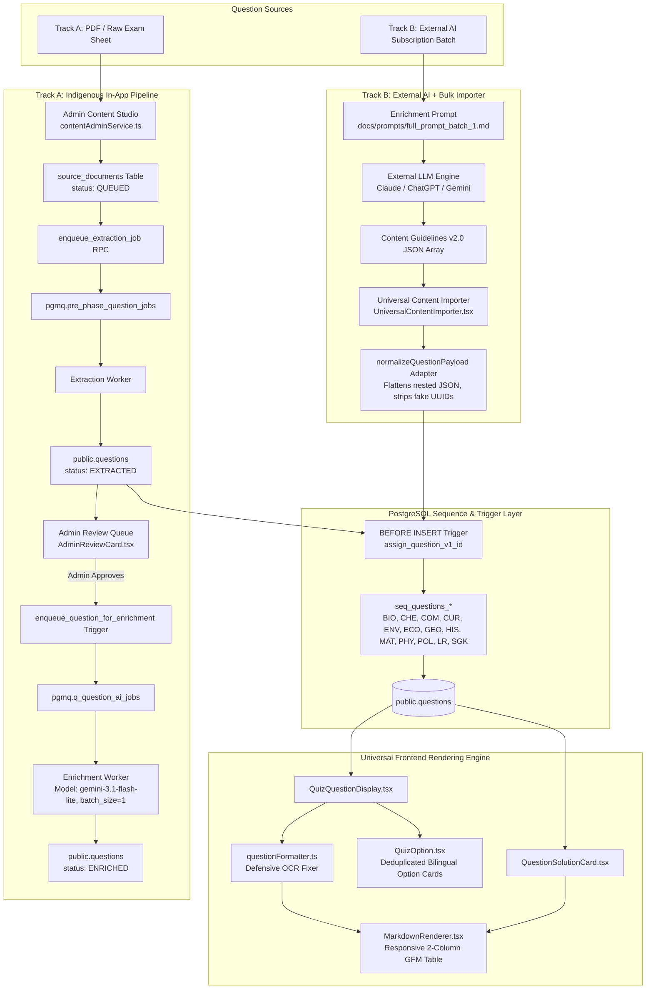

# MindFlow Question Ingestion, Enrichment & Serialization Architecture

## 1. Executive Summary & Philosophy

In competitive examination platforms, question presentation quality directly impacts learner comprehension and test fidelity. Standard single-line multiple-choice questions (MCQs) are trivial to format, but **matching-list / comparative-table questions** (e.g., matching Constitutional Articles with Provisions, Rivers with Originating States, or Taekwondo terms with definitions) present recurring structural challenges:
* OCR scans from past exam papers frequently mangle Roman numerals (`II` becomes `11`, `III` becomes `111`).
* Unstructured text extractors collapse tabular data into flattened, unreadable single-line paragraphs.
* Inconsistent manual ID assignment risks collisions and gaps in subject sequences.

To solve these challenges once and for all, MindFlow uses a **Two-Track Unified Question Ingestion & Enrichment Architecture** backed by an automated database sequence engine and a defensive client-side rendering pipeline.

---

## 2. The Two-Track Ingestion Architecture

MindFlow accommodates two distinct operational workflows:
1. **Track A (Indigenous In-App AI Pipeline):** For automated end-to-end ingestion from within the Admin Studio.
2. **Track B (External High-Throughput LLM + Admin Bulk Importer):** For bulk question enrichment using personal high-tier AI subscriptions (Claude 3.7 Sonnet, ChatGPT Plus, Gemini Pro) and single-click bulk database imports.



---

## 3. Chronological End-to-End Pipeline Steps

### Step 1: Raw Ingestion & OCR Sanitation
When exam papers are OCR-scanned, the layout engine frequently misinterprets two-column matching questions.
* **OCR Correction Dictionary:**
  | Mangled OCR String | Canonical Replacement |
  | :--- | :--- |
  | `List 11` / `List-11` | `List II` / `List-II` |
  | `List 111` / `List-111` | `List III` / `List-III` |
  | `सूची 11` / `सूची-11` | `सूची II` / `सूची-II` |
  | `सूची 111` / `सूची-111` | `सूची III` / `सूची-III` |
  | `11. ` (preceding item) | `II. ` |
  | `111. ` (preceding item) | `III. ` |
  | `D-l` / `C-l` (option code) | `D-1` / `C-1` (letter 'l' to digit '1') |

* **Preserving Table Boundaries:**
  The extractor must preserve column headers and row associations instead of stripping line breaks.

---

### Step 2: Canonicalization & GFM Table Structuring
**The Universal Rule:** No question containing matching pairs may be inserted into the database as a flattened, unstructured string. All matching questions **must** be canonicalized into a **GitHub Flavored Markdown (GFM) table** in both English (`question`) and Hindi (`question_hi`).

#### Standard English Markdown Structure:
```markdown
Match the following Constitutional Articles (List I) with their provisions (List II) and select the correct option:

| List I (Articles) | List II (Provisions) |
| :--- | :--- |
| I. Article 140 | 1. Formation of the Finance Commission |
| II. Article 280 | 2. Provision for President's Rule |
| III. Article 356 | 3. Ancillary powers of the Supreme Court |
```

#### Standard Hindi Markdown Structure:
```markdown
निम्नलिखित संवैधानिक अनुच्छेदों (सूची I) का उनके प्रावधानों (सूची II) के साथ मिलान करें और सही विकल्प का चयन करें:

| सूची I (अनुच्छेद) | सूची II (प्रावधान) |
| :--- | :--- |
| I. अनुच्छेद 140 | 1. वित्त आयोग का गठन |
| II. अनुच्छेद 280 | 2. राष्ट्रपति शासन का प्रावधान |
| III. अनुच्छेद 356 | 3. उच्चतम न्यायालय की आनुषंगिक शक्तियां |
```

#### Standard Option Representation:
Options must use standardized hyphenated pair codes:
```json
"options": [
  "I-1, II-2, III-3",
  "I-3, II-1, III-2",
  "I-2, II-3, III-1",
  "I-3, II-2, III-1"
]
```

---

### Step 3: Database Serialization & `v1_id` Sequence Management

#### The Database Sequence Engine
MindFlow utilizes PostgreSQL sequences managed by a centralized `BEFORE INSERT OR UPDATE` trigger: `assign_question_v1_id()`.

Each subject maintains its own sequence:
* `Biology` ➔ `seq_questions_bio` (Prefix: `BIO`)
* `Chemistry` ➔ `seq_questions_che` (Prefix: `CHE`)
* `Computer` ➔ `seq_questions_com` (Prefix: `COM`)
* `Current Affairs` ➔ `seq_questions_cur` (Prefix: `CUR`)
* `Ecology & Environment` ➔ `seq_questions_env` (Prefix: `ENV`)
* `Economics` ➔ `seq_questions_eco` (Prefix: `ECO`)
* `Geography` ➔ `seq_questions_geo` (Prefix: `GEO`)
* `History` ➔ `seq_questions_his` (Prefix: `HIS`)
* `Mathematics` ➔ `seq_questions_mat` (Prefix: `MAT`)
* `Physics` ➔ `seq_questions_phy` (Prefix: `PHY`)
* `Polity` ➔ `seq_questions_pol` (Prefix: `POL`)
* `Reasoning` ➔ `seq_questions_lr` (Prefix: `LR`)
* `Static GK` ➔ `seq_questions_sgk` (Prefix: `SGK`)

#### How Sequence Allocation Operates
1. **Omitted / Null `v1_id` (Recommended for Bulk Upload):**
   When `v1_id` is null or omitted in the payload:
   ```sql
   EXECUTE format('SELECT nextval(%L)', v_seq_name) INTO v_nextval;
   NEW.v1_id := v_prefix || v_nextval;
   ```
   Postgres automatically generates the continuous, monotonic next sequence number (e.g. `POL1116`, `POL1117`). There is **zero possibility of ID collision**, and the user never needs to inspect previous IDs before uploading.

2. **Explicit `v1_id` Provided (e.g., `POL72`):**
   If a valid prefix-coded ID is provided:
   * The trigger validates that the prefix matches `NEW.subject`.
   * It extracts the numeric portion and compares it against `v_current_seq_val`.
   * If the provided value exceeds the current sequence counter, it calls `SELECT setval(v_seq_name, v_imported_val, true)`, ensuring future automatic inserts will not collide with the imported ID.

3. **Placeholder IDs in JSON Arrays (e.g., `"id": "1"`, `"2"`):**
   The frontend `UniversalContentImporter` adapter (`normalizeQuestionPayload`) automatically identifies that `"1"` is not a valid UUID nor a coded `v1_id`. It discards the numeric `"id"` field, allowing Postgres to generate both a true UUID for `id` and the authoritative sequence string for `v1_id`.

---

### Step 4: AI Enrichment & Prompt Governance

For Track B (External AI Workflow), use [`docs/prompts/full_prompt_batch_1.md`](file:///d:/MindFlow-main/docs/prompts/full_prompt_batch_1.md).

#### Mandatory Schema Contract
Every enriched question must adhere to the 5-part explanation format:
```json
{
  "explanation": {
    "summary": "Bilingual statement of the correct answer.",
    "analysis_correct": "✅ **Why this is correct**\n\n- Detailed justification.\n\n✅ **यह सही क्यों है**\n\n- विस्तृत कारण।",
    "analysis_incorrect": "❌ **Why other options are incorrect**\n\n- Distractor breakdown.\n\n❌ **अन्य विकल्प गलत क्यों हैं**\n\n- अन्य विकल्पों का विश्लेषण।",
    "conclusion": "📝 **Concluding Note**\n\n- Conceptual key takeaway.\n\n📝 **निष्कर्ष**\n\n- मुख्य निष्कर्ष।",
    "fact": "💡 **Interesting Fact**\n\n- Exam-relevant trivia or historical context.\n\n💡 **रोचक तथ्य**\n\n- रोचक तथ्य।"
  }
}
```

---

### Step 5: Admin Bulk Ingestion with Intelligent Schema Adapter

[`UniversalContentImporter.tsx`](file:///d:/MindFlow-main/src/features/admin/components/UniversalContentImporter.tsx) handles both flat database schemas and nested Content Guidelines (v2.0) schemas:
* **Nested Path Mapping:**
  * `row.classification?.subject` ➔ `subject`
  * `row.classification?.topic` ➔ `topic`
  * `row.classification?.subTopic` ➔ `subTopic`
  * `row.sourceInfo?.examName` ➔ `examName`
  * `row.sourceInfo?.examYear` ➔ `examYear`
  * `row.sourceInfo?.examDateShift` ➔ `examDateShift`
  * `row.properties?.difficulty` ➔ `difficulty`
  * `row.properties?.questionType` ➔ `questionType`
* **Validation Guards:**
  * Ensures `options` is an array of at least 2 items.
  * Verifies that `correct` is an exact match to one of the entries in `options`.
  * Provides visual feedback confirming how many questions will receive automated database sequence IDs.

---

### Step 6: Frontend Dual-Column Responsive Rendering Engine

1. **Defensive Pre-Processing ([`questionFormatter.ts`](file:///d:/MindFlow-main/src/features/quiz/utils/questionFormatter.ts)):**
   Before markdown parsing, incoming strings are sanitized to repair legacy OCR Roman numeral corruptions and inject structural breaks if raw flattened lists are encountered.
2. **GFM Table Component Styling ([`MarkdownRenderer.tsx`](file:///d:/MindFlow-main/src/components/ui/MarkdownRenderer.tsx)):**
   Renders GFM tables with responsive horizontal scrolling (`overflow-x-auto min-w-[300px]`), styled headers with subtle brand tints, and high-contrast dark mode support.
3. **Bilingual Option Deduplication ([`QuizOption.tsx`](file:///d:/MindFlow-main/src/features/quiz/components/QuizOption.tsx)):**
   Suppresses rendering the secondary Hindi option box if `option_hi` is identical to `option`, preventing duplicated code strings (e.g. `I-3, II-1, III-2`).
4. **Post-Quiz Review Parity ([`QuestionSolutionCard.tsx`](file:///d:/MindFlow-main/src/features/quiz/components/QuestionSolutionCard.tsx)):**
   Replaces unformatted `<p>` elements with `<MarkdownRenderer>`, ensuring line breaks, tables, and latex formulas never collapse during exam reviews.

---

## 4. Verification & Quality Assurance Checklist

Run these diagnostics to audit existing and incoming questions:

### 1. Detect Flattened Unstructured Matching Questions
```sql
SELECT v1_id, substring(question from 1 for 100) as preview
FROM public.questions 
WHERE (question ILIKE '%Match %List%' OR question ILIKE '%Match Column%')
  AND question NOT LIKE '%|%|%'
  AND position(chr(10) in question) = 0;
```
*(Expected Result: 0 rows)*

### 2. Detect OCR Roman Numeral Artifacts
```sql
SELECT v1_id, question 
FROM public.questions 
WHERE question ~* '\b(List|Column|सूची)\s+(11|111)\b';
```
*(Expected Result: 0 rows)*

### 3. Verify Option and Correct Answer Integrity
```sql
SELECT v1_id, correct, options 
FROM public.questions 
WHERE NOT (correct = ANY(options));
```
*(Expected Result: 0 rows)*
