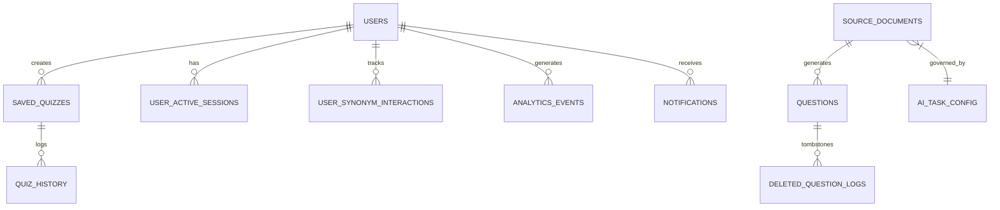

# 4. Database Architecture

## Overview
MindFlow utilizes PostgreSQL provided by Supabase. The database architecture is highly relational, utilizing schemas, enum types, Row Level Security (RLS) for multi-tenant isolation, and `pgmq` for asynchronous background job queuing.

## High-Level Schema & Relationships

## Core Domain Tables

### 1. User & Session Management
- `users` (Managed by Supabase Auth / GoTrue)
- `user_active_sessions`: Tracks current active device sessions.
- `app_ui_config`: Stores global application configurations.

### 2. Learning & Quiz Engine
- `saved_quizzes`: Stores metadata and configuration for user-created and assigned quizzes. Notably, this table does *not* have an `updated_at` column (queries must use `created_at`).
- `questions`: The core entity storing question data. The `options` and `options_hi` columns are PostgreSQL `text[]` arrays, not JSONB. Contains a lifecycle status enum (e.g., `APPROVED`, `ARCHIVED`, `ENRICHED`, `FAILED`).
- `deleted_question_logs`: Tombstone table for soft-deleted questions.

### 3. Vocabulary & Spaced Repetition
- `user_synonym_interactions`: Tracks spaced repetition intervals, mastery levels, and interactions with vocabulary terms.

### 4. AI & Content Ingestion Pipeline
- `source_documents`: Tracks uploaded PDFs/documents.
- `pgmq.q_question_ai_jobs` & `pgmq.a_question_ai_jobs`: Postgres message queues for active and archived AI enrichment jobs.
- `ai_task_config`: Configurations for AI processing, enforcing model selection (e.g., `gemini-3.1-flash-lite`) and batch sizes (`batch_size = 1`).
- `enrichment_dlq_archive`: Dead Letter Queue for permanently failed AI jobs (e.g., non-recoverable schema errors).

### 5. Community & Social
- `reels`, `reel_likes`, `reel_comments`: For community content sharing.
- `user_blocks`, `reports`: Moderation and community safety.

## Constraints & Enums
- **Enums:** `question_lifecycle_status` (Valid values: 'APPROVED', 'ARCHIVED', 'ENRICHED', 'ENRICHING', 'ENRICHMENT_PENDING', 'EXTRACTED', 'FAILED', 'PENDING_REVIEW', 'REJECTED'. Note: 'DRAFT' is not valid).
- **Arrays:** Arrays are heavily used for simple collections like multiple-choice options (`text[]`), requiring `array_length(col, 1)` rather than JSON lengths.

## Row Level Security (RLS) Policies
RLS is enabled on almost all tables.
- **User Data:** Standard `auth.uid() = user_id` for personal interactions, quizzes, and analytics.
- **Admin Data:** Tables like `ai_task_config` and `app_ui_config` are restricted to administrative roles via custom RLS functions or explicit UUID checks.

## Stored Procedures (RPCs)
RPCs handle complex transactional boundaries. Examples include:
- `submit_quiz_session_rpc`: Atomically finalizes a quiz score and updates history.
- `clone_shared_quiz_rpc`: Duplicates a community quiz into a user's local workspace.
- `get_execution_plan`: Acts as an Admission Controller for the AI queue, verifying model health and RPM limits.
- `export_user_data_rpc`: Handles GDPR data exports.
- `enqueue_extraction_job`: Triggers background extraction when a document is uploaded.

## Known Schema Issues & Inconsistencies
- **Missing Timestamps:** `saved_quizzes` lacks an `updated_at` column.
- **Data Mapping Mismatches:** Frontend models occasionally mismatch database column names (e.g., `source_pdf` vs `examName`, `phrase` vs `word`). The frontend handles this via explicit aliasing and fallback nullish operators (`??`).
- **Cache Invalidation:** Because of the heavy reliance on IndexedDB, database schema changes or bulk metadata updates require manually incrementing a `vocab_cache_cleared_vX` flag in the frontend configuration to force clients to refetch.

*Evidence:* `supabase/migrations/`, memory instructions.
*Confidence:* Confirmed.
