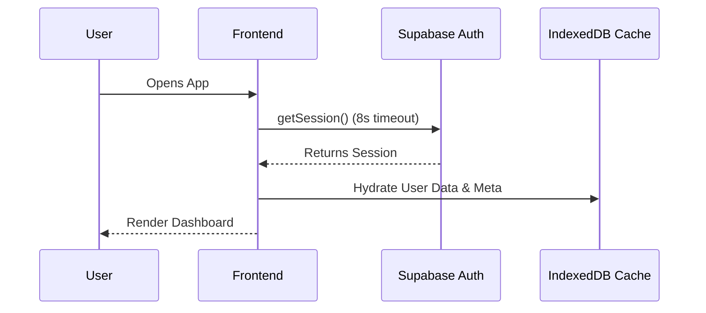
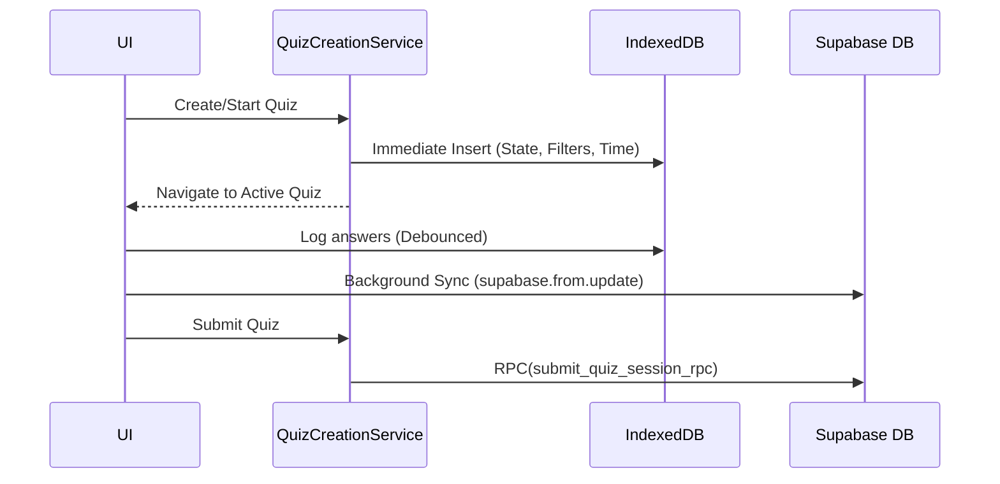
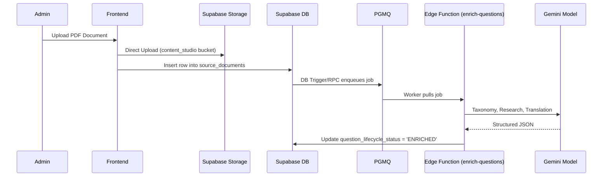

# 5. Data Flow Architecture

## Overview
MindFlow's data flow is characterized by an **Offline-First, Delta-Sync** approach for user progress (Quizzes, Vocab), and an **Asynchronous Queue-Driven** approach for backend processing (AI Enrichment).

## 1. Authentication Flow

*Note:* The 8s timeout prevents `gotrue-js` mutex deadlocks.

## 2. Quiz Session Flow (Offline-First)
Quizzes are heavily reliant on local storage to ensure uninterrupted learning.

*Constraint:* Quizzes MUST be seeded into IndexedDB immediately upon creation before progress updates can occur to prevent 'not found' sync errors. Mutations must be upsert-safe.

## 3. Background Metadata Sync (Delta Sync)
For bulk metadata (Vocab definitions, Quiz configs), the app avoids fetching entire tables.
1. Frontend checks local cache (IndexedDB) for last `updated_at`.
2. Frontend calls RPC `get_filtered_quiz_metadata(p_last_sync_at)`.
3. Backend returns only modified rows.
4. Frontend merges updates into IndexedDB.

## 4. AI Content Ingestion Pipeline

*Constraint:* Batch size is strictly 1 to avoid bypassing Gemini RPM limits. Infrastructure errors use exponential backoff via PGMQ visibility timeout (`vt`).

## 5. Vocabulary / Spaced Repetition (OWS, Idioms)
1. User interacts with a word (e.g., swipes a flashcard).
2. UI updates local Zustand store.
3. Zustand asynchronously updates IndexedDB.
4. Background worker syncs `user_synonym_interactions` to Supabase.
5. If the database schema for vocab changes, `vocab_cache_cleared_vX` flag in `localStorage` is bumped, forcing the frontend to clear IndexedDB and refetch entirely.

*Evidence:* Memory guidelines, `quizCreationService.ts`, `useQuizSessionStore.ts`, AI architecture docs.
*Confidence:* Confirmed.
