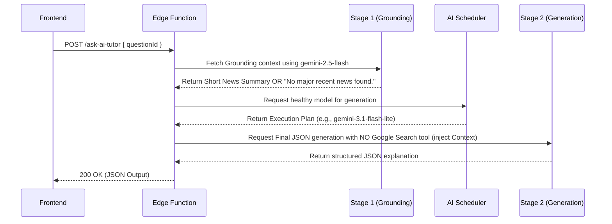

# AI Tutor Pipeline Architecture

## The Problem
The `ask-ai-tutor` Edge Function previously relied on Google Search Grounding to fetch recent news about the question's topic. It did this by passing `tools: [{ googleSearch: {} }]` directly in the payload to the primary generation model (e.g., `gemini-3.1-flash-lite`).

However, Google AI restricts the Search Grounding feature on the Free Tier for most `gemini-3.x` and `gemini-4.x` models. Requesting Grounding with these models immediately triggers a `429 RESOURCE_EXHAUSTED` error. The AI Scheduler caught this `429`, matching the word "quota", and incorrectly assumed the API key was completely exhausted for the day (`rpd_exhausted = true`). This resulted in a cascading failure where all AI keys were quarantined, shutting down the entire AI pipeline.

## The Two-Stage Pipeline Solution

To prevent `429` quota errors while maintaining the required Grounding functionality, we redesigned the `ask-ai-tutor` pipeline into a two-stage architecture.

### Pipeline Diagram

### Stage 1: The Grounding Layer

The exclusive responsibility of this stage is to interact with Google Search Grounding.
- **Model Used:** It specifically targets older/approved models that support Grounding on the Free Tier. By default, it targets `gemini-2.5-flash`, configurable via the `GROUNDING_MODEL` environment variable.
- **Payload:** It sends a short, specific prompt requesting a 2-3 sentence news summary along with `tools: [{ googleSearch: {} }]`.
- **Fallback Strategy:** If Stage 1 fails (e.g., due to model deprecation, network errors, or actual quota limits), it gracefully catches the error, sets the `recentNewsContext` to `"No major recent news found."`, and seamlessly proceeds to Stage 2. It does not throw an exception, nor does it poison the scheduler.

### Stage 2: The Generation Layer

This is the main workhorse that constructs the final JSON payload.
- **Model Used:** It dynamically retrieves the best, healthiest model from the `get_execution_plan` RPC (typically `gemini-3.1-flash-lite` or whatever is configured in `ai_task_config`).
- **Payload:** The critical change is the **complete removal** of the `tools: [{ googleSearch: {} }]` object. Instead, the context extracted from Stage 1 (`recentNewsContext`) is securely injected directly into the system instruction prompt.
- **Result:** The model performs high-quality reasoning without triggering Grounding restrictions, ensuring no false `429` quota blacklisting occurs.

## Why Grounding is Isolated

Isolating Grounding into Stage 1 decouples the high-quality reasoning models (like `gemini-3.x`) from the strict Free Tier billing constraints associated with the Google Search tools. This ensures:
- **No False Positives:** The scheduler accurately tracks real RPM/RPD limits rather than failing on Grounding access limits.
- **Future-Proofing:** We can easily upgrade the Generation models to new versions (e.g., `gemini-4.x`) without worrying about whether they support free Grounding.

## Future Maintenance Notes

- **`GROUNDING_MODEL` Env Var:** If Google modifies the Free Tier Grounding models (e.g., deprecating `gemini-2.5-flash`), update the `GROUNDING_MODEL` environment variable in the Supabase Edge Function Secrets to point to the new supported model. No code deployment is required.
- **Cost vs Performance:** While this uses two API calls, Stage 1 consumes very few tokens, keeping costs negligible. If a paid billing account is attached in the future, Stage 1 can be deprecated, and the tool array can be merged back into Stage 2.
