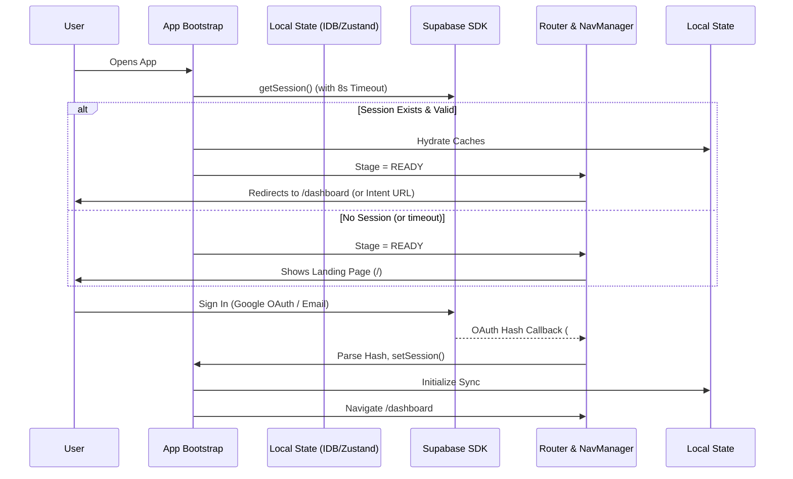

# Authentication Flow

Authentication is managed via Supabase `gotrue-js` integrated deeply into a strict Bootstrapping State Machine and globally accessible React Context.

## Auth Flow Architecture

## Key Files & Responsibilities

### `src/hooks/useAppBootstrap.ts`
- **Purpose:** The app's startup orchestration engine.
- **Responsibilities:**
  - Handles the Supabase Auth Mutex correctly.
  - Intercepts HashRouter fragments before React Router gets confused by OAuth redirects.
  - Ensures the DB schema/local cache (`DB_VERSION`) is ready.

### `src/features/auth/context/AuthContext.tsx`
- **Purpose:** Global Auth State Provider.
- **Responsibilities:**
  - Exposes `user`, `session`, `isLoading` to the UI tree.
  - Implements the `signOut` method.
  - **Crucial Rule:** `signOut` is wrapped in `try/catch` and forcefully wipes IndexedDB (`db.clearCache()`) and local states even if the Supabase network call fails, ensuring a secure local wipe.

### `src/hooks/useAppVisibilityReawakening.ts`
- **Purpose:** Handles mobile OS background/foreground lifecycles.
- **Responsibilities:** Prevents multiple `getSession()` calls from queuing up when the user minimizes and maximizes the app rapidly, which would otherwise deadlock the Supabase mutex.

## Guest Login
**Strictly Prohibited.** The platform requires real accounts for database Row Level Security (RLS) enforcement.
