# Folder Structure

MindFlow separates global layout/system logic from isolated feature logic.

```mermaid
graph TD
    src --> assets[assets/ - Static images and global styles]
    src --> components[components/ - Shared dumb UI and layout components]
    src --> constants[constants/ - Global enums and config]
    src --> features[features/ - Isolated domain logic FSD]
    src --> hooks[hooks/ - Global system hooks]
    src --> layouts[layouts/ - Root page wrappers]
    src --> lib[lib/ - 3rd-party setup IDB, Supabase]
    src --> pages[pages/ - Global root pages]
    src --> providers[providers/ - Global React Contexts]
    src --> routes[routes/ - Central route tables]
    src --> services[services/ - Global API calls]
    src --> stores[stores/ - Global Zustand state]
    src --> types[types/ - Global TS interfaces]
    src --> utils[utils/ - Global pure functions]
```

## Detailed Directory Breakdown

### `src/components/`
**Purpose:** Reusable, stateless UI primitives and global layout blocks.
**What belongs here:** `Button.tsx`, `Modal.tsx`, `Header.tsx`, `BottomNavigation.tsx`.
**What NEVER belongs here:** API calls, Supabase logic, Feature-specific state (e.g. `QuizTimer.tsx`).

### `src/features/`
**Purpose:** The core of the app. Every independent business domain.
**What belongs here:** Folders like `auth/`, `quiz/`, `social/`. Inside each, they can have their own internal `components/`, `hooks/`, `utils/`.
**What NEVER belongs here:** Logic that handles routing across the whole app, or bootstrapping logic.

### `src/hooks/`
**Purpose:** Hooks that span across multiple features or interact with core system APIs.
**Examples:** `useAppBootstrap.ts` (Startup), `useHardwareBackButton.ts` (Capacitor Android).

### `src/lib/`
**Purpose:** Setup and initialization for external SDKs.
**Important files:** `supabase.ts` (client instance + global timeout fetcher), `db.ts` (IndexedDB schema definition).

### `src/providers/`
**Purpose:** Global React contexts that wrap the `<App />`.
**Examples:** `AppProvider.tsx` (Theme/Toast), `PresenceProvider.tsx` (Realtime user status), `ErrorBoundary.tsx`.

### `src/routes/`
**Purpose:** The single source of truth for URL mapping.
**Important files:** `AppRoutes.tsx`.
