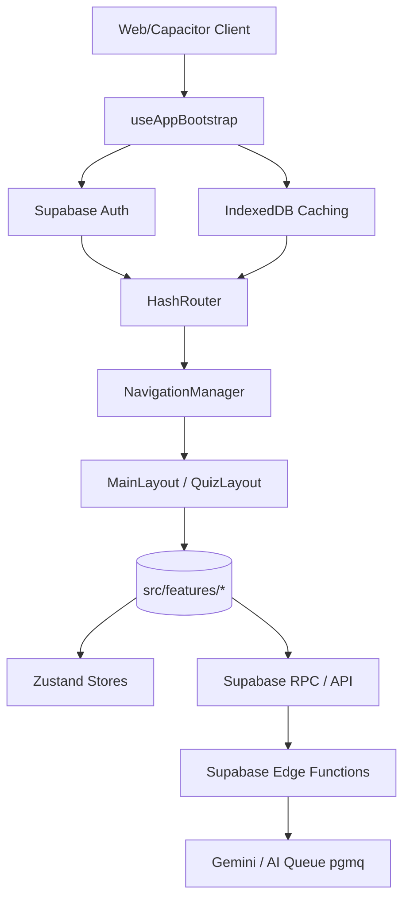

# Repository Architecture

The MindFlow repository is structured around a combination of **Feature-Sliced Design (FSD)** for the frontend domain logic and **Serverless Edge-Driven** capabilities via Supabase.

## High-Level Architectural Flow

## Architectural Pillars

### 1. The Bootstrap State Machine
The app does not load components arbitrarily. `useAppBootstrap.ts` enforces a strict State Machine (`BOOTSTRAPPING`, `READY`, `FAILED`, `MAINTENANCE`, `UPDATE_REQUIRED`). It resolves OAuth hash parameters, establishes session mutices, and hydrates offline IndexedDB caches before relinquishing control to React Router.

### 2. Feature-Sliced Modules
Code belongs in `src/features/[domain]`. Deep imports across features are prohibited; modules expose APIs via barrel files (`index.ts`).
For example, `src/features/quiz` knows about internal quiz state, but `src/features/social` only interacts with `quiz` via its public hooks/components.

### 3. Policy-Based Navigation
Instead of component-level route guards (`<ProtectedRoute>`), routing delegates to `NavigationManager` which uses explicit Policy engines (`AuthPolicy`, `OnboardingPolicy`). This removes ambiguous flash-of-unauthenticated-content issues.

### 4. Background Sync & Local-First (Delta Sync)
Metadata for large vocab or quiz datasets is fetched via RPC endpoints querying strictly `updated_at > last_sync`. State is serialized into `IndexedDB` (`src/lib/db.ts`). Zustand stores read from IDB.

### 5. Idempotent AI Job Queueing
User uploads go to Supabase Storage -> Trigger to Postgres -> Enqueued in `pgmq`. Edge Functions process the queue asynchronously using the `gemini-3.1-flash-lite` model.
