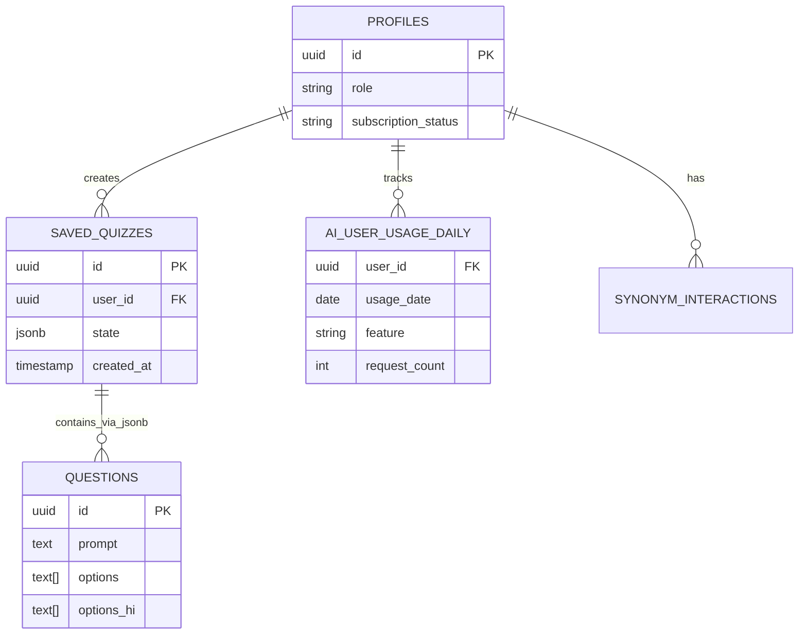

# Backend & Database Architecture

MindFlow relies on Supabase as its Backend-as-a-Service (BaaS), leveraging PostgreSQL, GoTrue for Authentication, Storage, and Edge Functions (Deno).

## 1. Supabase Integration

- **Client Configuration:** Located in `src/lib/supabase.ts`.
- **Runtime Stabilization:** The client implements a custom `fetchWithTimeout` and a critical `withAuthTimeout` wrapper (8-second mutex timeout). This prevents the Supabase GoTrue client from permanently locking the app if a background network request hangs during transitions. **[Confirmed]**

## 2. Authentication & Authorization

- **Auth Flow:** Uses Supabase Auth (GoTrue). Supports Google OAuth (configured via Capacitor plugin for Android native). **[Confirmed]**
- **No Guest Access:** The system strictly prohibits guest login; all interactions require an authenticated user row in `profiles`. **[Confirmed]**
- **Role-Based Access Control (RBAC):** Handled via the `profiles` table (e.g., `role = 'admin'`). `AuthPolicy.isAdmin` checks both hardcoded emails and the profile role. **[Confirmed]**

## 3. Database Schema Overview

The database uses PostgreSQL. Key tables include:

- `profiles`: User information, subscription status, roles.
- `questions`: Core quiz data. Contains PostgreSql `text[]` arrays for `options` and `options_hi` (Hindi). **[Confirmed]**
- `saved_quizzes`: Stores generated quiz sessions. Includes `activeQuestions`, `filters`, and `state`. **[Confirmed]**
- `ai_user_usage_daily` & `ai_feature_config`: Telemetry and governance for AI features.
- Various domain-specific tables (`idioms`, `ows`, `synonyms`) and interaction tracking tables.

### 3.1 Row Level Security (RLS)
The app relies heavily on RLS policies to secure data. Most tables have policies restricting `SELECT`, `INSERT`, `UPDATE` to the authenticated `auth.uid()`. **[Confirmed]**

### 3.2 Migrations
Migrations are stored in `supabase/migrations/`. Recent migrations indicate a mature database with features for:
- Soft deletes and tombstones (`20260707000001_questions_tombstones.sql`).
- Telemetry (`20260801000000_ai_pipeline_observability.sql`).
- Complex RPCs for idemptotency and cloning (`20260517100002_make_rpc_idempotent.sql`).

## 4. Edge Functions & AI

Edge Functions (Deno) reside in `supabase/functions/`. The primary capability is AI interaction.

- **`chat-ai`:** Handles the "Ask AI Tutor" feature.
- **Provider:** Google Gemini API. **[Confirmed]**
- **Governance:** `_shared/ai/governance.ts` handles rate limiting and quotas. It relies on a strictly atomic Postgres RPC (`check_and_increment_ai_quota`) to prevent race conditions during high load. **[Confirmed]**

## 5. Potential Risks & Technical Debt

- **Missing Constraints / Foreign Keys:** While specific missing indexes require a runtime schema dump to verify completely, the codebase implies heavy reliance on `user_id` lookups. Ensuring indexes exist on `(user_id, last_interacted_at)` across interaction tables is crucial for performance. **[Highly Likely]**
- **JSONB Parsing:** The `saved_quizzes.state` column relies on JSONB. If the frontend schema changes (e.g., `activeQuestions` structure), backend RPCs or Edge functions querying inside this JSON block could break. **[Possible]**

## Entity Relationship (ER) Diagram (Core Concepts)

