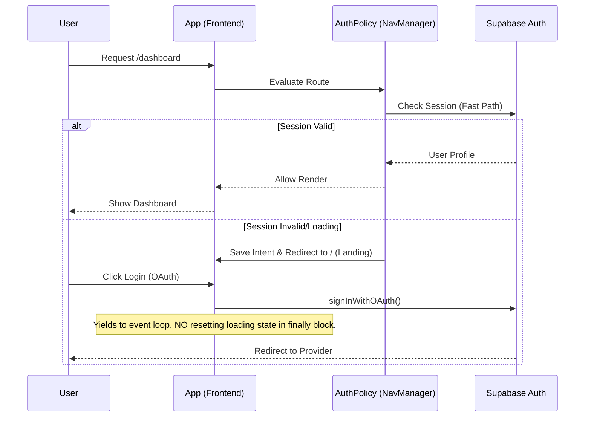
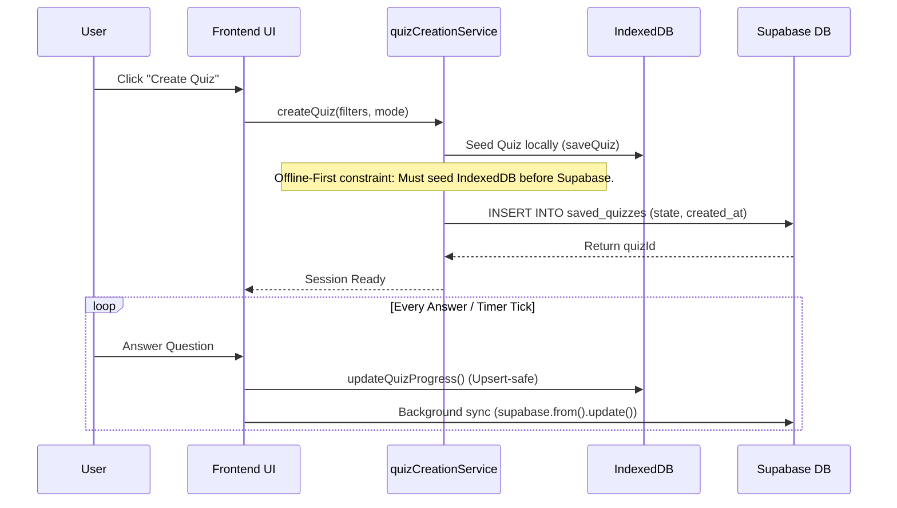
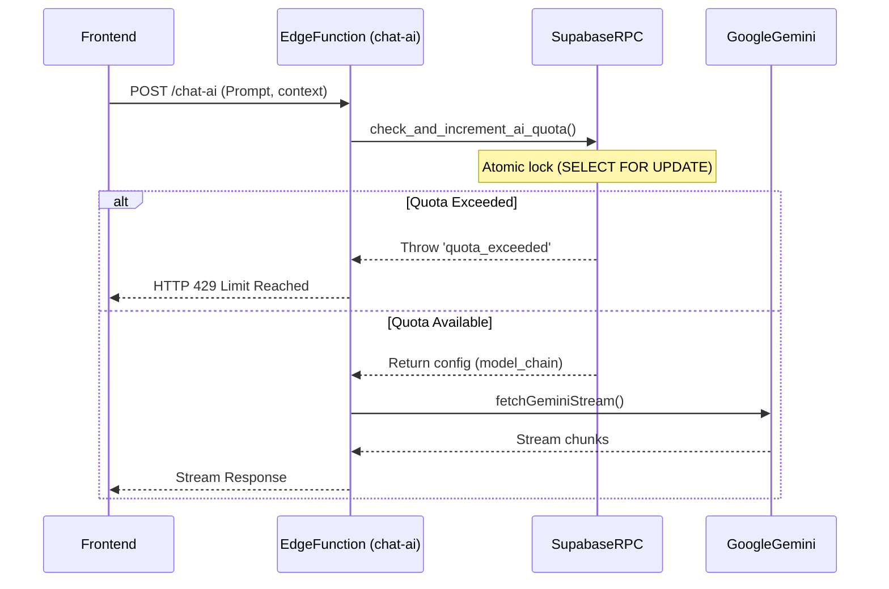

# End-to-End Data Flow

This document maps the flow of data through critical application paths.

## 1. Authentication Flow

The authentication flow utilizes a single-gate architecture where unauthenticated users hit the public landing page, and authenticated users are routed internally.

## 2. Quiz Session Lifecycle

Quiz sessions are heavily managed by the frontend `quizCreationService` and persisted offline-first.

## 3. Data Synchronization (Offline-First Delta Sync)

MindFlow uses a Delta Sync architecture for bulk metadata (e.g., vocab cards, quiz configs).

1. **App Load:** Frontend queries `syncService`.
2. **Local Check:** Reads `last_sync_at` from `localStorage` or IndexedDB.
3. **Delta Request:** Calls Supabase RPC (e.g., `get_filtered_quiz_metadata(p_last_sync_at)`).
4. **Merge:** New or modified rows are merged into IndexedDB.
5. **Cache Invalidation:** If schema changes (flagged via `vocab_cache_cleared_vX`), IndexedDB is wiped and a full sync occurs.

## 4. AI Tutor Flow (Edge Function)

