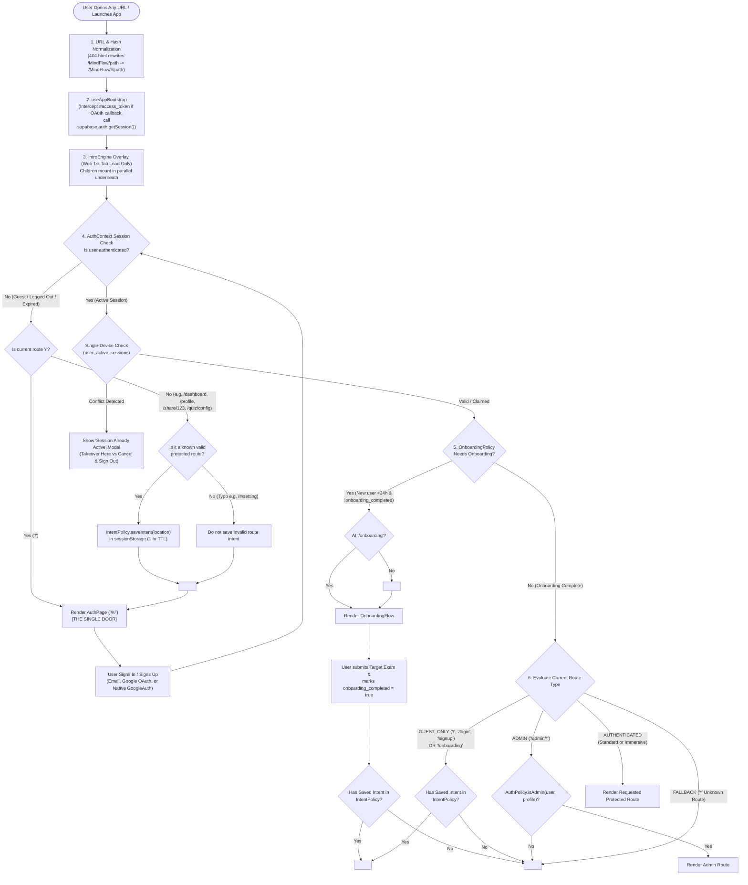
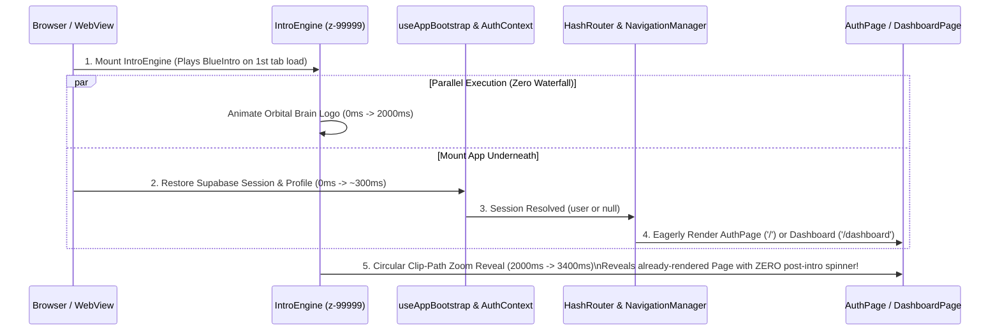

# MindFlow Navigation & User Flow Audit & Production Architecture Proposal

---

## Executive Summary & Product Vision Alignment

**Product Vision:** MindFlow operates as a gated, authentication-first learning product. **The Authentication Portal (`/#/`) is the Single Door into the application.** No user—whether arriving via root URL, bookmarked route, shared quiz link, browser refresh, or Capacitor Android launch—may access any internal route or directory without an authenticated, authorized session and completed onboarding.

This document provides:
1. **Step 1 — Forensic Audit of the Existing Implementation** (Routing, Bootstrap, Auth, Session Persistence, Guards, Capacitor vs. Web, and a complete Visual Inventory of all Screen Loaders).
2. **Step 2 — Brainstorm & Architectural Weaknesses** (Uncovering 9 critical vulnerabilities, including 25+ routes currently bypassing `NavigationManager`, competing redirect loops, non-hash 404s on GitHub Pages, and sequential loader waterfalls).
3. **Step 3 — The Ideal Production-Grade Navigation Architecture** (Complete rules, Mermaid flowcharts, decision trees, and deterministic behavior across all 14 user scenarios and edge cases).

---

## Step 1 — Forensic Investigation of Existing Implementation

### 1.1 Entry Point & Router Topology (`src/App.tsx` & `src/hooks/useAppBootstrap.ts`)

1. **Bootstrap Phase (`useAppBootstrap.ts`)**:
   - Runs before `<HashRouter>` or `<AuthProvider>` mounts.
   - **OAuth Hash Interception (Guardrailed)**: Inspects `window.location.hash` for `access_token=`. If present, strips leading `#/` / `#/#`, extracts `access_token` and `refresh_token`, calls `supabase.auth.setSession()`, sets `sessionStorage.setItem('mindflow_booted', 'true')`, and cleans the URL via `window.history.replaceState(null, '', window.location.pathname + window.location.search)`.
   - Calls `supabase.auth.getSession()` to warm the Supabase client cache.
   - Transitions `BootstrapStage` from `'BOOTSTRAPPING'` $\rightarrow$ `'READY'` (or `'OFFLINE_INITIALIZATION'` if offline on error).
2. **Root Component (`src/App.tsx`)**:
   - While `!bootstrapState.isReady`, renders a full-screen `<SynapticLoader size="xl" />`.
   - Once ready, mounts:
     ```
     ErrorBoundary
       └── IntroEngine
             └── HashRouter
                   └── AppProvider (QueryClientProvider -> ThemeAndBrandingInjector -> AuthProvider)
                         ├── AppVisibilityWrapper (useAppVisibilityReawakening)
                         └── PresenceProvider
                               ├── PWAUpdateManager
                               ├── VersionBanner
                               └── AppRoutes (QuizProvider -> AppRoutesContent)
     ```

---

### 1.2 Complete Inventory of Screen Loaders, Splash Screens & Skeletons

As requested, below is every screen loader, splash animation, and skeleton currently in the codebase, along with its exact trigger condition and visual dynamics:

| # | Loader / Splash Name | File Location | Where & When It Appears | Visual Look & Dynamics (How to Identify It) |
| :- | :--- | :--- | :--- | :--- |
| **1** | **Native Android Launch Splash** (`@capacitor/splash-screen`) | `capacitor.config.ts` | Capacitor Android cold start (first `2000ms`, `launchAutoHide: true`). | Pure pitch-black (`#000000`) full-screen native Android window (`CENTER_CROP` splash resource, no spinner) before WebView paints. |
| **2** | **BlueIntro** (*"Blue Splash Reveal"* — Default `IntroEngine`) | `src/features/intro/modules/blue/BlueIntro.tsx` & `.css` | First load of a browser tab when `mindflow_intro_played_v2` and `mindflow_booted` are not in `sessionStorage` and no OAuth token is in hash. | Full-screen overlay (`z-[99999]`). Radial blue/purple tint over white (light) or `#0f172a` dark-bluish slate (dark). Features a `200x200px` elastic pop-in orbital system with a spinning purple/indigo conic-gradient halo ring (`mf-halo-ring`) around a breathing `90x90px` rounded square (`mf-core-logo`) drawing a white SVG brain outline (`mf-brain-path`), with bold **"MindFlow"** text sliding up below. Transitions out after `2000ms` by expanding a circular indigo-to-purple gradient `clip-path` (`zoom-overlay`) from `0px` to `150vmax` over `1.4s`, then fading opacity over `0.65s` (guarded by an `8000ms` max watchdog in `IntroEngine`). |
| **3** | **MinimalFadeIntro** (*"Minimal Fade"* — `IntroEngine` option) | `src/features/intro/modules/minimal-fade/MinimalFadeIntro.tsx` | When selected in Admin AppConfig (`config.intro.active === 'minimal-fade'`). | Full-screen solid white (`dark:bg-slate-950`) overlay with a `64x64px` high-contrast rounded square brain icon and tracked uppercase `MINDFLOW` text (`tracking-[0.2em]`), smoothly fading out over `1s`. |
| **4** | **ParticleIntro** (*"AI Particle"* — `IntroEngine` option) | `src/features/intro/modules/particle/ParticleIntro.tsx` | When selected in Admin AppConfig (`config.intro.active === 'particle'`). | Full-screen HTML5 `<canvas>` with a radial `indigo-950` $\rightarrow$ `slate-950` background, 50 drifting `indigo-400` nodes connected by dynamic proximity lines (`< 100px`), and bold white `MINDFLOW` centered text. |
| **5** | **WelcomeIntro** (*Legacy/Feature Audio-Visual Intro*) | `src/features/quiz/components/Landing/WelcomeIntro.tsx` | Triggered manually via Quiz Landing flow (`5000ms` duration). | Frosted backdrop (`bg-slate-50/95 dark:bg-slate-900/95 backdrop-blur-xl`), pulsing `800px` indigo glow, `AnimatedLogo` drawing neural synapses, **"Welcome to MindFlow — IGNITING YOUR CURIOSITY"** typography, accompanied by a synthesized Web Audio API low-pass filter sweep + `880Hz` chime. |
| **6** | **Core `SynapticLoader`** (*Primary App Spinner*) | `src/components/ui/SynapticLoader.tsx` | 1. `App.tsx` during `useAppBootstrap` (`size="xl"`).<br>2. `NavigationManager` while `AuthContext.loading` is true (`size="lg"`).<br>3. `AppRoutes` & `AppLayout` `<Suspense>` fallbacks.<br>4. `QuizSessionGuard`, `ResultGuard`, `DeckSessionGuard`, `ShareGatekeeper`. | Google Play-style morphing SVG ring (`google-spinner-group`) whose perimeter organically waves between a circle and a multi-lobed star (`4s` loop) with an indigo-to-pink (`#EC4899`) gradient stroke, surrounding a centered pulsing Lucide `<Brain />` icon (`sm`: 32px, `md`: 48px, `lg`: 64px, `xl`: 96px). |
| **7** | **Auth Portal Suspense Skeleton** | `src/routes/AppRoutes.tsx` (lines 208–220) | Top-level `<Suspense>` fallback specifically when `location.pathname === '/'`. | Full-screen `slate-50` / `dark:slate-900` background with two blurred indigo/purple corner orbs and a centered `max-w-md` `animate-pulse` wireframe: one tall `h-64 rounded-3xl` block over three `h-12 rounded-xl` input bar placeholders. |
| **8** | **Quiz `CookingLoader`** (*"Chef Bot & Kadahi"*) | `src/features/quiz/components/CookingLoader.tsx` | `QuizConfig` question bank syncing, `BlueprintBuilder`, `BlueprintPreviewWrapper`, `ExamBlueprintsHubPage`. | Card containing an animated SVG scene of a cyan-eyed blinking **Chef Robot** stirring purple soup inside a traditional *kadahi* wok over flickering orange/yellow flames, rising purple steam wisps, and floating `?` bubbles. Every 25% progress, the entire 3D SVG scene flips `180deg` (`rotateY`). Below it: dynamic cooking status text (*"Warming up the neural network..."*, *"Cooking your questions..."*) and a `140x140px` glowing orange morphing burner ring displaying `0%–100%`. |
| **9** | **Vocab `SynapticLoader`** (*"Curating Lexicon"*) | `src/features/vocab/synonyms/SynapticLoader.tsx` | Vocabulary Synonyms loading state. | Large glassmorphic card (`max-w-[800px]`) titled **"Curating Lexicon — Discovering nuances"**. Renders an `800x450` SVG orbital starfield with counter-rotating dashed rings, a central glowing progress ring cycling serif italic verbs (*"Weaving"*, *"Refining"*, *"Curating"*), and cyan-dotted vocabulary words (*"eloquent"*, *"profound"*, *"nuanced"*) shooting outward along dashed violet lines. |
| **10** | **Feature Skeletons & Inline `Loader2`** | `ShimmerBlock.tsx`, `Skeletons.tsx`, `PostCardSkeleton.tsx`, `ReelSkeleton.tsx`, `AiExplanationButton.tsx` | Inside mounted pages while React Query fetches data or buttons submit. | Grey/slate `animate-pulse` rectangular/circular blocks matching cards, reels, chat lists, or AI explanations; plus spinning Lucide `<Loader2 className="animate-spin" />` inside action buttons. |

---

### 1.3 Current Route Classification & Guard Audit (`src/routes/AppRoutes.tsx`)

Currently, routes in `AppRoutes.tsx` are divided into four blocks, **one of which has a major security omission**:

1. **Onboarding Route (`/onboarding`, line 225)**:
   - Wrapped in `<NavigationManager type={RouteAccessType.AUTHENTICATED}>`.
2. **Guest Entry / Auth Routes (`/`, `/login`, `/signup`, lines 227–235)**:
   - `/` renders `<NavigationManager key="guest" type={RouteAccessType.GUEST_ONLY}><AuthPage /></NavigationManager>`.
   - `/login` and `/signup` immediately `<Navigate to="/" replace />`.
3. **Standard App Layout Routes (lines 238–350)**:
   - Wrapped in `<Route element={<NavigationManager key="auth" type={RouteAccessType.AUTHENTICATED}><AppLayout /></NavigationManager>}>`.
   - Protects `/dashboard`, `/mcqs`, `/english`, `/profile/*`, `/settings/*`, `/mcqs/test-series/*`, `/quiz/library`, `/quiz/analytics`, `/quiz/bookmarks`, `/vocab/*/root`, `/about/*`, `/result/:quizId`, `/flashcards/summary`, `/community/*`, `/messages`, `/u/:username`, `/school/*`, `/tools`, `/notification`, `/ai/*`, and 3 PDF/text tools.
4. **Immersive Session & Standalone Routes (lines 352–515) — ❌ UNPROTECTED BY `NavigationManager`!**
   - Because `<Route element={<NavigationManager ...><AppLayout /></NavigationManager>}>` closes on **line 350**, **every single route between line 355 and line 515 is outside `NavigationManager`!**
   - Specifically, the following **25 routes** lack `<NavigationManager>` protection:
     - `/vocab/ows/library`, `/vocab/idioms/library`, `/vocab/synonyms/library`
     - `/vocab/ows/session/:deckId`, `/vocab/idioms/session/:deckId`, `/vocab/synonyms/session/:deckId`
     - `/vocab/ows/result/:deckId`, `/vocab/idioms/result/:deckId`, `/vocab/synonyms/result/:deckId`
     - `/vocab/idioms/config` and `/vocab/ows/config` *(also duplicated at lines 249–250!)*
     - `/share/:originalQuizId`
     - `/quiz/config`
     - `/quiz/live/:id`
     - `/quiz/session/learning/:quizId`, `/quiz/session/mock/:quizId`, `/quiz/session/god/:quizId`
     - `/vocab/idioms/session`, `/vocab/synonyms/session`, `/vocab/ows/session`
     - `/vocab/synonyms/phase1`, `/vocab/synonyms/list`, `/vocab/synonyms/quiz`
     - `/tools/flashcard-maker`, `/tools/ascii-art-hub`, `/tools/ascii-art/number`, `/tools/ascii-art/invisible-ink`, `/tools/ascii-art/stego`
5. **Fallback Route (`*`, line 517)**:
   - `<Route path="*" element={<Navigate to={ROUTES.HOME} replace />} />`
6. **Admin Routes (`/admin/*`, lines 519–537)**:
   - Individually wrapped in `<NavigationManager type={RouteAccessType.ADMIN}>`.

---

## Step 2 — Brainstorm: Weaknesses, Inconsistencies & Edge Cases

### 2.1 Security & Access Control Flaws (Violations of the "Single Door" Vision)
1. **25 Immersive & Tool Routes Bypass `NavigationManager` Completely**:
   - If an unauthenticated user opens `https://aklabx.github.io/MindFlow/#/tools/flashcard-maker`, `#/tools/ascii-art-hub`, `#/quiz/config`, `#/vocab/ows/library`, or `#/vocab/synonyms/quiz`, **the page renders directly without login!**
2. **`DeckSessionGuard` Infinite Spinner Hang on Logged-Out Deep Links**:
   - In `DeckSessionGuard.tsx` (line 25): `if (!deckId || !user) return;` returns early before `setLoading(false)` is ever called. If a logged-out user opens `#/vocab/ows/session/deck-123`, `NavigationManager` does not wrap it, so `DeckSessionGuard` mounts and renders `<SynapticLoader />` **forever**.
3. **`QuizSessionGuard` and `ResultGuard` Show Dead-End Error Screens Instead of Redirecting to Login**:
   - Because `/quiz/session/*` works outside `NavigationManager`, if an unauthenticated user opens `#/quiz/session/learning/abc`, `QuizSessionGuard` catches `!session?.user` and renders an `<ErrorState message="Please login to continue." actionText="Go Back to Dashboard" />` instead of saving the deep link in `IntentPolicy` and redirecting cleanly to `/`.

### 2.2 Competing Redirect Engines & Deep-Link Intent Loss
4. **Three Competing Post-Login Redirect Mechanisms**:
   - **Mechanism A (`NavigationManager` + `IntentPolicy`)**: Saves unauthenticated deep links to `sessionStorage['mindflow_redirect_intent']` and restores them when `user` becomes authenticated on `GUEST_ONLY` (`/`).
   - **Mechanism B (`AuthPage.tsx` lines 87–93)**: Has a manual `useEffect` watching `user`:
     ```tsx
     if (user) {
       const params = new URLSearchParams(location.search);
       const returnTo = params.get('returnTo');
       const destination = returnTo && returnTo.startsWith('/') ? returnTo : '/dashboard';
       navigate(destination, { replace: true });
     }
     ```
     **Why this is broken**: When a user logs in on `/`, `AuthPage`'s `useEffect` fires `navigate('/dashboard')` *ignoring* `IntentPolicy` (stored in `sessionStorage`) and *ignoring* `OnboardingPolicy` (`/onboarding`)! It directly races with `NavigationManager`.
   - **Mechanism C (`ShareGatekeeper.tsx` line 24)**: Redirects unauthenticated users via `navigate('/?returnTo=/share/' + originalQuizId)` instead of using `NavigationManager` + `IntentPolicy`.
5. **Useless "Back to Dashboard" Button on `AuthPage`**:
   - `AuthPage.tsx` (lines 226–232) renders a top-left `<ArrowLeft />` button with `title="Back to Dashboard"` wired to `onBack={() => {}}` (a no-op in `AppRoutes.tsx` line 230). Since `AuthPage` is the single entry door for unauthenticated users, a non-functional "Back to Dashboard" button on the login screen is confusing UX and should be removed.
6. **`ProfilePage` Sign-Out Callback Navigates to `/dashboard`**:
   - In `AppRoutes.tsx` line 242: `<ProfilePage onSignOut={() => navigate(ROUTES.DASHBOARD)} />`. Navigating to `/dashboard` right after signing out triggers a redundant hop (`/profile` $\rightarrow$ `/dashboard` $\rightarrow$ `IntentPolicy.saveIntent('/dashboard')` $\rightarrow$ `/`). Sign-out should navigate directly to `/` (`PlatformPolicy.getLogoutRoute()`) and clear any saved intent.

### 2.3 URL & Hosting Edge Cases (GitHub Pages + HashRouter)
7. **Opening `https://aklabx.github.io/MindFlow/dashboard` (Without `#`) Returns a GitHub Pages 404**:
   - Because MindFlow is hosted on GitHub Pages at `/MindFlow/` and uses `<HashRouter>`, any URL without `#` (such as `https://aklabx.github.io/MindFlow/dashboard` or `https://aklabx.github.io/MindFlow/login`) requests a physical file `/MindFlow/dashboard` from GitHub's static CDN.
   - Currently, `public/404.html` **does not exist**. Thus, GitHub Pages serves its generic 404 error page instead of redirecting to `https://aklabx.github.io/MindFlow/#/dashboard`.
8. **Invalid / Non-Existent Routes (`/#/setting`, `/#/random-xyz`) Save Dirty Intent or Lose Feedback**:
   - Currently, `ROUTES.FALLBACK` (`*`) does `<Navigate to={ROUTES.HOME} replace />`.
   - If a **logged-in** user types `/#/setting` (a typo for `/#/settings`), `*` redirects them to `/` (`ROUTES.HOME`), and then `NavigationManager` on `/` redirects them to `/dashboard` (a double redirect hop: `/setting` $\rightarrow$ `/` $\rightarrow$ `/dashboard`).

### 2.4 Startup Latency & Double Splash / Loader Waterfall
9. **`IntroEngine` Blocks React Router & Auth Initialization While Playing**:
   - Look at `IntroEngine.tsx` lines 132–146: when `hasPlayed` is `false` (first load), `IntroEngine` renders `<IntroComponent />` **without rendering `{children}` underneath**!
   - Because `<HashRouter>`, `<AppProvider>`, and `<AuthProvider>` are `children` of `<IntroEngine>`, **React does not even mount `AuthProvider` or fetch the user's profile until AFTER the 4-second `BlueIntro` animation finishes!**
   - Consequently, the user waits 4 seconds for `BlueIntro`, and *only after `BlueIntro` vanishes* does `AuthProvider` mount and show *another* `<SynapticLoader />` while fetching the profile and resolving routes!
   - Furthermore, on Capacitor Android cold start, the native `SplashScreen` shows for 2 seconds (`#000000`), followed by `useAppBootstrap` `SynapticLoader`, followed by `BlueIntro` (4 seconds), followed by `AuthProvider` `SynapticLoader`—a 4-stage loader waterfall!

---

## Step 3 — The Ideal Production-Grade Navigation Architecture

### 3.1 Core Architectural Principles ("The Single Door Architecture")

1. **Zero Unprotected Internal Routes**:
   - Every route in `AppRoutes.tsx` must be inside a `<NavigationManager>` layout route:
     - **Group 1 (`GUEST_ONLY`)**: `/` (The Single Door `AuthPage`), with `/login` and `/signup` aliasing to `/`.
     - **Group 2 (`ONBOARDING`)**: `/onboarding` (Requires authentication; if already onboarded, redirects to intent or `/dashboard`).
     - **Group 3 (`AUTHENTICATED` — Standard Layout)**: Wraps `<AppLayout />` for all tabbed/standard pages.
     - **Group 4 (`AUTHENTICATED` — Immersive Layout)**: A single `<Route element={<NavigationManager key="auth-immersive" type={RouteAccessType.AUTHENTICATED}><Outlet /></NavigationManager>}>` wrapping all fullscreen quiz, flashcard, live room, share gatekeeper, and tool session routes.
     - **Group 5 (`ADMIN`)**: A single `<Route element={<NavigationManager key="admin" type={RouteAccessType.ADMIN}><Outlet /></NavigationManager>}>` wrapping all `/admin/*` routes.
2. **One Canonical Redirect & Intent Engine (`NavigationManager` + `IntentPolicy`)**:
   - Remove the competing `useEffect` redirect in `AuthPage.tsx` and the manual `?returnTo=` redirect in `ShareGatekeeper.tsx`.
   - `NavigationManager` is the **sole authority** that decides when to redirect across `/`, `/onboarding`, `/dashboard`, or a saved deep-link intent.
3. **Parallel Background Hydration Under `IntroEngine`**:
   - Render `{children}` underneath `IntroEngine`'s `fixed inset-0 z-[99999]` overlay from `t = 0ms`. While the 3.5s `BlueIntro` animation plays on first boot, `HashRouter`, `AuthProvider`, and `NavigationManager` resolve the session and pre-render `AuthPage` or `DashboardPage` underneath so that when the `BlueIntro` circle expands, the final screen is **already painted with zero post-intro spinners**.
4. **GitHub Pages Non-Hash URL Normalization (`public/404.html` + Bootstrap Normalizer)**:
   - Add a lightweight `public/404.html` that intercepts non-hash requests like `https://aklabx.github.io/MindFlow/dashboard` and rewrites them to `https://aklabx.github.io/MindFlow/#/dashboard` before boot.

---

### 3.2 Master Navigation Decision Tree (Mermaid Flowchart)



---

### 3.3 Route Access Rules & Classification Table

| Route Category | Access Type | Target Paths | Unauthenticated Behavior | Authenticated (Not Onboarded) | Authenticated (Onboarded) |
| :--- | :--- | :--- | :--- | :--- | :--- |
| **Auth Portal (Single Door)** | `GUEST_ONLY` | `/` | Renders `<AuthPage />` | Redirects to `/onboarding` | Pops `IntentPolicy` $\rightarrow$ redirects to `intent` or `/dashboard` |
| **Auth Aliases** | Alias $\rightarrow$ `/` | `/login`, `/signup` | Redirects to `/` | Redirects to `/onboarding` | Redirects to `/dashboard` |
| **Onboarding** | `ONBOARDING` | `/onboarding` | Redirects to `/` (does not save `/onboarding` as intent) | Renders `<OnboardingFlow />` | Pops `IntentPolicy` $\rightarrow$ redirects to `intent` or `/dashboard` |
| **Core App (With `AppLayout`)** | `AUTHENTICATED` | `/dashboard`, `/mcqs`, `/english`, `/profile/*`, `/settings/*`, `/community/*`, `/messages`, `/u/:username`, `/school/*`, `/tools`, `/notification`, `/ai/*`, `/quiz/library`, `/quiz/analytics`, `/quiz/bookmarks`, `/result/:quizId`, `/flashcards/summary`, `/about/*` | Saves path + query in `IntentPolicy` $\rightarrow$ Redirects to `/` | Saves path in `IntentPolicy` $\rightarrow$ Redirects to `/onboarding` | Renders route inside `<AppLayout />` |
| **Immersive Fullscreen Routes (No `AppLayout`)** | `AUTHENTICATED` | `/quiz/config`, `/quiz/session/*/:quizId`, `/quiz/live/:id`, `/share/:originalQuizId`, `/vocab/*/library`, `/vocab/*/session*`, `/vocab/*/result/:deckId`, `/vocab/synonyms/phase1`, `/vocab/synonyms/list`, `/vocab/synonyms/quiz`, `/tools/flashcard-maker`, `/tools/ascii-art*` | Saves path + query in `IntentPolicy` $\rightarrow$ Redirects to `/` | Saves path in `IntentPolicy` $\rightarrow$ Redirects to `/onboarding` | Renders fullscreen route + session hydration guard (`QuizSessionGuard` / `DeckSessionGuard` / `ShareGatekeeper`) |
| **Admin Routes** | `ADMIN` | `/admin/*` | Saves path in `IntentPolicy` $\rightarrow$ Redirects to `/` | Redirects to `/onboarding` | If `isAdmin`: renders route.<br>If non-admin: redirects to `/dashboard` with toast `"Admin access required"`. |
| **Unknown / Typo Routes** | `FALLBACK` (`*`) | Any unmatched path (e.g., `/#/setting`, `/#/random`) | Redirects to `/` **without** saving the invalid URL as intent | Redirects to `/onboarding` | Redirects directly to `/dashboard` |

---

### 3.4 Detailed Walkthrough of All 14 Scenarios

#### Scenario 1: First-Time Visitor (Never Visited Before, Unauthenticated)
1. **What they see first**:
   - Opens `https://aklabx.github.io/MindFlow/` (or any link).
   - On web, `IntroEngine` plays the `BlueIntro` splash animation once per browser tab session (`mindflow_intro_played_v2`), while `<HashRouter>` and `<AuthProvider>` initialize concurrently underneath.
   - Because there is no active session, the user lands on **the Single Door: `AuthPage` (`/#/`)**. There is no separate public marketing landing page—`AuthPage` itself serves as the branded entry portal (complete with the interactive 3-question "Try a Quick Demo Quiz" modal built into `AuthPage` if they want to preview questions before signing up).
2. **What happens on Sign Up / First Login**:
   - User signs up with Email/Password or Google OAuth.
   - `AuthContext` establishes the session.
   - `NavigationManager` evaluates `OnboardingPolicy.shouldRedirectToOnboarding(user)` $\rightarrow$ returns `true` (account created $< 24$ hours ago and `user_metadata.onboarding_completed !== true`).
   - User is automatically routed to `/#/onboarding` (`<OnboardingFlow />`).
3. **What happens after Onboarding**:
   - User enters their name (if not provided by Google) and selects their **Target Exam** (SSC, Banking, Railways, State PSC, Other).
   - `OnboardingFlow` updates `supabase.auth.updateUser({ data: { onboarding_completed: true, full_name, target_exam } })` and marks `localStorage['onboarding_status_<userId>'] = 'COMPLETED'`.
   - `OnboardingFlow` pops `IntentPolicy.popIntent()`:
     - If they originally clicked a shared quiz link (e.g., `/#/share/abc`), they are taken directly to `/#/share/abc`.
     - Otherwise, they land on `/#/dashboard`.

#### Scenario 2: Returning Visitor (Not Logged In)
- Opens `https://aklabx.github.io/MindFlow/`.
- If in a new tab, `BlueIntro` plays while `AuthPage` mounts underneath; if in the same tab, `AuthPage` renders immediately.
- Lands on `/#/` (`AuthPage`).
- Once they log in, because `OnboardingPolicy.shouldRedirectToOnboarding(user)` is `false` (already completed or account $> 24$ hours old), they bypass `/onboarding` and go directly to `/#/dashboard` (or their saved deep-link intent).

#### Scenario 3: Returning Visitor with an Active Authenticated Session
- Opens `https://aklabx.github.io/MindFlow/`.
- `useAppBootstrap` and `AuthContext` restore the session from `localStorage` via `supabase.auth.getSession()`.
- `NavigationManager` on `/` (`GUEST_ONLY`) detects `user !== null` and `shouldRedirectToOnboarding(user) === false`.
- Immediately executes `<Navigate to="/dashboard" replace />`.
- User lands directly on `/#/dashboard`.

#### Scenario 4: User Already Logged In Opens `https://aklabx.github.io/MindFlow/`
- Browser resolves `https://aklabx.github.io/MindFlow/` $\rightarrow$ HashRouter reads path `/`.
- `NavigationManager` (`GUEST_ONLY`) sees authenticated `user` $\rightarrow$ redirects (`replace: true`) to `/#/dashboard` (or `/#/onboarding` if onboarding was never finished).
- The `/` login screen never flashes because `AuthPage` and `DashboardPage` are eagerly bundled and `NavigationManager` evaluates synchronously during render.

#### Scenario 5: User Directly Opens `https://aklabx.github.io/MindFlow/dashboard` (Non-Hash URL) or `https://aklabx.github.io/MindFlow/#/dashboard`
- **Case 5A — Non-Hash URL (`/MindFlow/dashboard`)**:
  - GitHub Pages serves `public/404.html`, which runs a 0ms inline script converting `/MindFlow/dashboard` $\rightarrow$ `https://aklabx.github.io/MindFlow/#/dashboard` via `window.location.replace(...)`.
- **Case 5B — Hash URL (`/#/dashboard`)**:
  - **If Logged In**: `NavigationManager` (`AUTHENTICATED`) verifies `user` is present and onboarded $\rightarrow$ renders `<Dashboard />` inside `<AppLayout />`.
  - **If Logged Out**: `NavigationManager` (`AUTHENTICATED`) saves `/dashboard` in `IntentPolicy` (`sessionStorage`) and renders `<Navigate to="/" replace />`. The URL becomes `https://aklabx.github.io/MindFlow/#/` and displays `AuthPage`. Upon login, `IntentPolicy.popIntent()` sends them to `/#/dashboard`.

#### Scenario 6: User Directly Opens `https://aklabx.github.io/MindFlow/#/login` While Already Logged In
- `<Route path="/login" element={<Navigate to="/" replace />} />` normalizes `/login` $\rightarrow$ `/`.
- On `/`, `NavigationManager` (`GUEST_ONLY`) synchronously sees `user !== null` and redirects (`replace: true`) to `/#/dashboard` (or `/#/onboarding` if not yet onboarded).
- History stack remains clean (`replace: true`), so pressing Back does not loop back to `/login`.

#### Scenario 7: User Opens Any Protected Route Directly (e.g., `/#/profile`, `/#/settings`, `/#/quiz/config`, `/#/tools/flashcard-maker`, `/#/admin`)
- **If Logged Out**:
  1. All internal routes (both `AppLayout` and immersive fullscreen routes) are wrapped in `NavigationManager`.
  2. `NavigationManager` saves `{ pathname, search, hash }` into `sessionStorage['mindflow_redirect_intent']` with a 1-hour TTL.
  3. `NavigationManager` redirects (`replace: true`) to `/#/` (`AuthPage`).
  4. User logs in on `AuthPage` $\rightarrow$ `NavigationManager` pops the saved intent and redirects (`replace: true`) back to the exact protected route they requested.
- **If Logged In (Standard User) Opening `/#/admin`**:
  1. `NavigationManager` (`ADMIN`) checks `AuthPolicy.isAdmin(user, profile)`.
  2. Since false, redirects (`replace: true`) to `/#/dashboard`.

#### Scenario 8: User Opens the Application Through a Deep Link (e.g., Shared Quiz `/#/share/quiz-uuid-123` or Community Post `/#/community/post/456`)
- **If Logged Out**:
  1. `NavigationManager` intercepts `/share/quiz-uuid-123`, saves `/share/quiz-uuid-123` to `IntentPolicy` in `sessionStorage`, and redirects (`replace: true`) to `/#/` (`AuthPage`).
  2. Even if the user logs in via **Google OAuth redirect** (which leaves the site and returns to `https://aklabx.github.io/MindFlow/#/#access_token=...`), `sessionStorage` survives same-tab navigation!
  3. `useAppBootstrap` processes the OAuth tokens, sets the Supabase session, and cleans the URL to `/#/`.
  4. `NavigationManager` on `/` detects the newly authenticated user:
     - If they are a brand-new user, routes to `/#/onboarding` first, and upon completing onboarding, `OnboardingFlow` pops `IntentPolicy` and routes them to `/#/share/quiz-uuid-123`!
     - If they are an existing user, `NavigationManager` immediately pops `IntentPolicy` and routes them to `/#/share/quiz-uuid-123`!
  5. `ShareGatekeeper` mounts with an authenticated `user`, clones the shared quiz via `supabase.rpc('clone_shared_quiz')`, and redirects to `/#/quiz/session/<mode>/<new_quiz_id>`.

#### Scenario 9: Browser Refresh (`F5` / Pull-to-Refresh on Any Route)
- `sessionStorage.getItem('mindflow_intro_played_v2')` is already `'true'` in the current tab, so `IntroEngine` **skips** the splash intro immediately (`0ms` delay).
- `useAppBootstrap` restores the Supabase session from `localStorage`.
- `HashRouter` preserves the exact `#/current/path`.
- **If on a standard route (e.g., `/#/english?tab=vocabows`)**: Re-renders `<EnglishHub />` on the exact tab.
- **If on an active quiz or deck session (e.g., `/#/quiz/session/learning/123` or `/#/vocab/ows/session/456`)**:
  - `QuizSessionGuard` / `DeckSessionGuard` detects that in-memory Zustand state was wiped by the refresh, compares `IndexedDB` (`db.getQuiz(quizId)`) timestamps with Supabase (`saved_quizzes`), hydrates the sliding 50-question window, and resumes the user on the exact question index they were on.

#### Scenario 10: Capacitor Android App Cold Start
1. Native Android displays the `#000000` Capacitor `SplashScreen`.
2. **Optimization**: On Capacitor Native (`Capacitor.isNativePlatform() === true`), `IntroEngine` should either skip `BlueIntro` or hide the native `SplashScreen` (`SplashScreen.hide()`) as soon as `useAppBootstrap` finishes so the user never experiences two consecutive splash screens.
3. WebView loads `index.html` at `#/`.
4. `useAppBootstrap` restores the session from persistent storage:
   - **If Logged Out**: Renders `AuthPage` (`/#/`). When user taps "Continue with Google", uses native `@codetrix-studio/capacitor-google-auth` (`GoogleAuth.signIn()` $\rightarrow$ `supabase.auth.signInWithIdToken()`), completely avoiding external browser redirects.
   - **If Logged In**: `NavigationManager` redirects `#/` $\rightarrow$ `#/dashboard`.
5. **Hardware Back Button (`useHardwareBackButton.ts`)**:
   - On `/` or `/dashboard`, pressing Back shows toast `"Press back again to exit"` and exits the app on a second press within `2000ms` via `App.exitApp()`.
   - On deep routes, deterministically navigates up the hierarchy (Level 2 $\rightarrow$ Level 1 $\rightarrow$ `/dashboard`).

#### Scenario 11: App Resume from Background (Mobile Tab Switch / Android App Switcher)
- Handled by `useAppVisibilityReawakening.ts` (`visibilitychange` on Web/PWA + `CapacitorApp.addListener('appStateChange')` on Android).
- **Crucial Rule**: Resuming from background **never** triggers `IntroEngine`, **never** unmounts `<HashRouter>` or `<AppRoutes>`, and **never** resets scroll position or form state.
- Silently runs:
  1. `queryClient.resumePausedMutations()`
  2. `focusManager.setFocused(true)` & `onlineManager.setOnline(true)`
  3. Debounced `supabase.auth.getSession()` to refresh the JWT if it expired while backgrounded.
- Simultaneously, `AuthContext`'s `user_active_sessions` realtime channel checks if another device took over the session while backgrounded.

#### Scenario 12: Expired Session or Multi-Device Session Hijack
- **Case 12A — JWT Refresh Token Expired / Revoked**:
  - When `supabase.auth.getSession()` fails to refresh an expired token, Supabase emits `onAuthStateChange('SIGNED_OUT', null)`.
  - `AuthContext` resets all user-scoped Zustand stores (`QuizSession`, `Analytics`, `Flashcard`, `Sync`, `Bookmark`, `Social`, `DeckSession`), clears `queryClient`, wipes `IndexedDB` (`db.clearAllUserData()`), and sets `user = null`.
  - `NavigationManager` on the currently active protected route immediately detects `user === null`, saves the current route in `IntentPolicy`, and redirects (`replace: true`) to `/#/` (`AuthPage`).
- **Case 12B — Multi-Device Session Conflict (`user_active_sessions`)**:
  - If Device B logs into the same account and chooses **"Yes, Continue Here"**, Device A receives the Postgres Realtime update (`remoteSessionToken !== currentLocalToken`), calls `forceEvict()`, sets `sessionStorage.setItem('mindflow_eviction_notice', 'true')`, scrubs local caches, and redirects to `/#/`.

#### Scenario 13: Network Unavailable (Offline Cold Start & Mid-Session Offline)
- **Case 13A — Offline Cold Start**:
  - `useAppBootstrap` catches any network error when `!navigator.onLine` and transitions to `stage: 'OFFLINE_INITIALIZATION'` with `isReady: true`.
  - `supabase.auth.getSession()` reads the cached session token from `localStorage`.
  - If a cached session exists, `AuthContext` sets `user` from the local session (catching the failed `profiles` fetch gracefully without blocking `setLoading(false)`).
  - User enters `/#/dashboard` and can review cached quizzes/bookmarks stored in IndexedDB (`db.ts`), while `useSyncStore` queues any mutations until connectivity returns.
  - If no cached session exists while offline, user lands on `/#/` (`AuthPage`), where attempting to sign in displays a clear network error message.
- **Case 13B — Dropping Offline Mid-Session**:
  - User is **not** logged out or redirected.
  - React Query pauses outgoing mutations (`onlineManager`), and `QuizSessionGuard` / `useQuizSessionStore` saves quiz progress locally to `IndexedDB`.

#### Scenario 14: User Logs Out (Intentional Sign Out)
1. User clicks **Sign Out** in `ProfilePage` or `SettingsPage`.
2. `AuthContext.signOut()` sets `isAuthTransitioning = true`, clears `queryClient`, resets all 7 Zustand stores, removes persisted `localStorage` keys (`mindflow_analytics`, `mindflow_bookmarks`, etc.), deletes the row in `user_active_sessions`, clears `IntentPolicy.clearIntent()` so the next login doesn't restore the previous user's last URL, calls `supabase.auth.signOut({ scope: 'global' })`, and clears `IndexedDB`.
3. `NavigationManager` (or the sign-out handler) navigates with `{ replace: true }` directly to `PlatformPolicy.getLogoutRoute()` (`/#/`).
4. User lands cleanly on `AuthPage` (`/#/`) with zero stale data in memory or storage.

---

### 3.5 Loader Consolidation & UX Polish Matrix

To make MindFlow feel instantaneous and production-grade, loaders must follow strict non-overlapping rules:



| Lifecycle Stage | Current Behavior (Multi-Loader Waterfall) | Proposed Production Behavior (Zero-Waterfall) |
| :--- | :--- | :--- |
| **1. First Tab Load (Cold Web Start)** | `useAppBootstrap` `SynapticLoader` $\rightarrow$ `BlueIntro` (blocks children) $\rightarrow$ `AuthContext` `SynapticLoader` $\rightarrow$ Page | `BlueIntro` plays **while** `useAppBootstrap`, `AuthContext`, and eager `AuthPage`/`DashboardPage` mount underneath. When `BlueIntro` expands its circular reveal, the target screen is already rendered. |
| **2. Same-Tab Refresh (`F5`)** | `useAppBootstrap` `SynapticLoader` $\rightarrow$ `NavigationManager` `SynapticLoader` $\rightarrow$ `Suspense` `SynapticLoader` | Single unified `<SynapticLoader size="xl" />` centered on matching theme background (`bg-slate-50 dark:bg-slate-900`) until both `bootstrapState.isReady` and `!auth.loading` resolve, then direct render. |
| **3. Capacitor Android Cold Start** | Native black splash (`2000ms`) $\rightarrow$ `BlueIntro` (`3500ms`) $\rightarrow$ `SynapticLoader` | Skip web `BlueIntro` on native Android (`Capacitor.isNativePlatform()`) or use `BlueIntro` as the single splash while hiding native splash immediately on WebView ready. |
| **4. Route Transitions (`/dashboard` $\rightarrow$ `/mcqs`)** | Full-screen `SynapticLoader` inside `<AppLayout>` | Keep `<AppLayout>` (bottom nav + header) persistent; show lightweight `<SynapticLoader size="lg" />` or page skeleton only inside `<Outlet />` content area. |
| **5. Domain-Specific Heavy Processes** | `CookingLoader` (Quiz sync/generation) & Lexical `SynapticLoader` (Synonyms curation) | Retain as signature brand moments when syncing/generating quiz questions or curating vocabulary decks. |

---

## Summary of Actionable Improvements (Pending Your Approval)

Once you approve this architecture, the implementation will cleanly address all findings without touching your guardrailed `<HashRouter>` or OAuth hash interception logic:

1. [x] **Enforce the "Single Door" Across All Routes (`src/routes/AppRoutes.tsx`)**:
   - Wrap all 25 currently unprotected immersive/fullscreen routes (lines 355–515) inside an authenticated `<Route element={<NavigationManager key="auth-immersive" type={RouteAccessType.AUTHENTICATED}><Outlet /></NavigationManager>}>` group.
   - Remove the duplicate `/vocab/idioms/config` and `/vocab/ows/config` route declarations.
   - Update the `*` fallback route so unknown URLs redirect cleanly without polluting `IntentPolicy`.
2. [x] **Unify Redirects & Fix Deep-Link Intent Restoration (`AuthPage.tsx`, `ShareGatekeeper.tsx`, `NavigationManager.tsx`)**:
   - Remove the competing `useEffect` redirect and the non-functional "Back to Dashboard" button from `AuthPage.tsx`, letting `NavigationManager` + `IntentPolicy` + `OnboardingPolicy` handle all post-login routing deterministically.
   - Remove manual `/?returnTo=` from `ShareGatekeeper.tsx` in favor of `NavigationManager` + `IntentPolicy`.
   - Fix `ProfilePage`'s `onSignOut` callback in `AppRoutes.tsx` and clear `IntentPolicy` on explicit sign-out.
3. [x] **Eliminate the Post-Intro Loader Waterfall (`src/features/intro/IntroEngine.tsx`)**:
   - Render `{children}` underneath the `IntroEngine` overlay while the intro plays so authentication and initial route rendering finish *behind* the intro curtain before it opens.
4. [x] **GitHub Pages Non-Hash URL Normalization (`public/404.html`)**:
   - Add a static `public/404.html` redirector so opening `https://aklabx.github.io/MindFlow/dashboard` (without `#`) automatically normalizes to `https://aklabx.github.io/MindFlow/#/dashboard`.
5. **Capacitor Deep Link & Admin Role Hardening (`AuthPolicy.ts`, `useAppBootstrap.ts`)**:
   - Check both `user.email === 'admin@mindflow.com'` and `profile?.role === 'admin'` in `AuthPolicy`.
   - Add `App.addListener('appUrlOpen')` support for native Android deep links.

---

> **Status:** Audit and Architecture Proposal complete. No application code has been modified. Waiting for your review and approval before implementing any changes.
