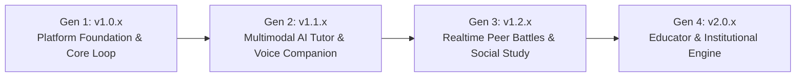

# MindFlow Multi-Generation Architecture Blueprint (main_blueprint.md)

This document outlines the macro architectural trajectory of the MindFlow platform across generations of product and engineering milestones.

---

## Generational Roadmap Overview

---

## 🏛️ Generation 1: Platform Foundation & Core Loop (v1.0.x - Current Active Generation)
**Strategic Goal:** Build a rock-solid, offline-first exam preparation platform with native Android APK feel, robust social messaging, and zero-latency local state.
- **Milestones:** M1 through M10 (Detailed in [`v1.0_blueprint.md`](file:///d:/MindFlow-main/docs/blueprint/v1.0_blueprint.md)).
- **Core Invariants:**
  - Single State Ownership ("One Concept $\rightarrow$ One Control").
  - Offline-first IndexedDB rendering (0ms boot).
  - Modern Web Guidance (MWG) baseline web primitives.
  - Native Android gesture & tactile touch uplift.
  - Autonomous 1-Chat = 1-Version engineering workflow.

---

## 🤖 Generation 2: Multimodal AI Tutor & Live Audio (v1.1.x)
**Strategic Goal:** Embed real-time conversational AI tutoring directly into question analysis and test reviews.
- **Key Capabilities:**
  - Gemini Multimodal Live API bidirectional audio stream (16kHz PCM $\rightarrow$ 24kHz PCM).
  - Voice-driven problem solving with dynamic KaTeX mathematical whiteboard syncing.
  - Edge function question enrichment pipeline with automatic diagram and concept synthesis.

---

## ⚔️ Generation 3: Realtime Collaborative Social Learning (v1.2.x)
**Strategic Goal:** Transform solo exam prep into interactive peer-to-peer learning with multiplayer capabilities.
- **Key Capabilities:**
  - Head-to-head live 60-second quiz showdowns powered by Supabase Realtime Channels.
  - Ephemeral voice-study lounges inside subject hubs.
  - Realtime anti-cheat telemetry and synchronized clock timers.

---

## 🎓 Generation 4: Institutional & Educator Platform (v2.0.x)
**Strategic Goal:** Scale MindFlow for coaching centers, tutors, and educational institutions.
- **Key Capabilities:**
  - Multi-tenant educator portal for custom curriculum and test series creation.
  - Automated question paper ingestion from PDF/DOCX via Gemini multimodal vision.
  - Cohort analytics, weak-topic heatmaps, and automated remediation assignments.
