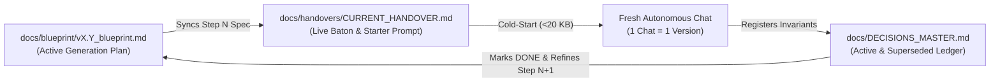

# MindFlow Multi-Generation Master Blueprint (main_blueprint.md)

> **Document Role:** Macro-level product trajectory and multi-generation index for the MindFlow platform.  
> **Operating Philosophy:** **Feature-by-Feature Hardening.** Do not scatter effort across unrelated new features. Lock onto **one existing feature area at a time**, harden it end-to-end until it is **bug-free, fast, native-grade UI/UX, and secure/safe**, and only then unlock the next generation.

---

## 1. North Star Product Vision

MindFlow is a fast, offline-first, Android-native-feel exam preparation platform (React 19 + TypeScript + Vite + TailwindCSS + Capacitor Android + Supabase + IndexedDB) tailored for competitive Indian exam aspirants (starting with **BPSC** and **SSC CGL**). Every feature in MindFlow must deliver:
1. **Zero Broken Flows:** No dead placeholders, no missing save buttons, no schema mismatches, and zero silent failures.
2. **Instant Speed:** 0ms local hydration from IndexedDB (`DEC-0004`) and `<16ms` interactive frame budgets (`DEC-0007`).
3. **Native Android Craft:** Tactile touch targets (`>=44x44px`, `active:scale-95`), keyboard-aware bars, and logical hierarchical back navigation (`DEC-0002`, `DEC-0008`).
4. **Defense-in-Depth Security:** Strict RBAC (`public.is_admin()`), privacy-safe RLS policies, zero leaked secrets, and validated inputs.

---

## 2. Closed-Loop Blueprint Planning Engine

### Rolling-Horizon Planning Rule
- **Step 1 (Next Immediate Version):** High-definition, execution-ready spec (exact files, circuit breakers, runtime test).
- **Steps 2–5:** Medium detail (concrete deliverables, boundaries, and verification targets).
- **Remaining Steps (6+):** High-level strategic vision (refined as earlier steps close).
- **Future Generations:** Strictly **PARKED** until the active generation hits its graduation milestone.

---

## 3. Multi-Generation Roadmap Table

| Generation | Version Span | Focus Area & Core Theme | Blueprint File | Status |
| :---: | :---: | :--- | :--- | :---: |
| **Gen 1A** | `v1.0.310` $\rightarrow$ `v1.0.366` | **Platform Foundation & Workflow Engine:** Canonical Exam Registry (`DEC-0001`), Offline-First Dexie (`DEC-0004`), Option B Launch (`DEC-0005`), MWG Top-Layer (`DEC-0007`), Android Uplift (`DEC-0008`), Social Chatroom Reskin (`DEC-0011`–`0012`), and Autonomous 1-Chat = 1-Version Engine (`DEC-0013`). | Archived in [`DECISIONS_MASTER.md`](../DECISIONS_MASTER.md) | `[x] COMPLETED` |
| **Gen 1B** | `v1.0.367` $\rightarrow$ `v1.0.380` | **Admin Panel & Dedicated BPSC Prepared Mock Tests Hardening:** Make the existing Admin Mock Tests CMS (`categories`, `series`, `tests`, `question-builder`, admin shell/RBAC) and the Student Dedicated BPSC Prepared Mock Tests experience 100% bug-free, fast, native UI/UX, and secure end-to-end. | [`v1.0_blueprint.md`](./v1.0_blueprint.md) | `[x] COMPLETED` |
| **Gen 2** | `v1.0.381` $\rightarrow$ `v1.0.390` | **Community Chatrooms & Study Rooms Hardening (`src/features/community/`):** Harden database RLS/indexes (`chat_room_messages`, `chat_message_reactions`), Realtime v2 channel resilience, offline outbox queuing, WebM voice notes, Android keyboard/swipe ergonomics, native `<dialog>` moderation menus, media compression, community feeds, and E2E verification. | [`v2.0_blueprint.md`](./v2.0_blueprint.md) | `[ ] ACTIVE` |
| **Gen 3** | `v1.1.0` $\rightarrow$ `v2.0.0` | **Future Platform Expansion (Parked):** New net capabilities (realtime peer quiz battles, study lounges, institutional educator workflows). Strictly frozen until existing core features are rock-solid. | *Created upon Gen 2 completion* | `[ ] PARKED` |

---

## 4. Template & Governance Links

- **Generation Blueprint Template:** [`docs/blueprint/00-blueprint-template.md`](./00-blueprint-template.md)
- **Active Generation Blueprint:** [`docs/blueprint/v2.0_blueprint.md`](./v2.0_blueprint.md)
- **Completed Gen 1B Blueprint:** [`docs/blueprint/v1.0_blueprint.md`](./v1.0_blueprint.md)
- **Live Handover Baton:** [`docs/handovers/CURRENT_HANDOVER.md`](../handovers/CURRENT_HANDOVER.md)
- **Master Decision Ledger:** [`docs/DECISIONS_MASTER.md`](../DECISIONS_MASTER.md)
